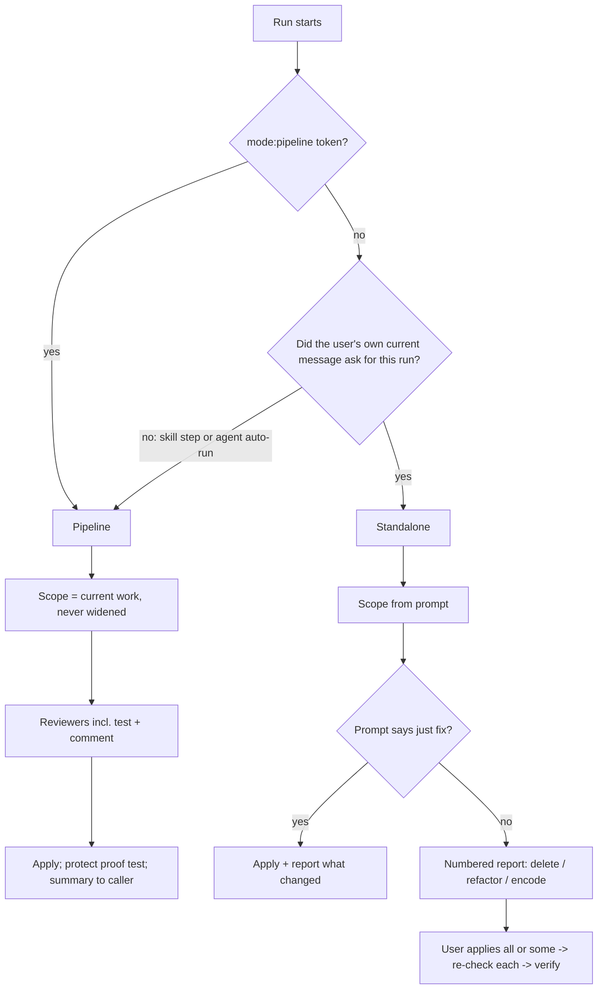

# Test and Comment Pruning in ce-simplify-code - Plan

## Goal Capsule

- **Objective:** Developers using the plugin end up with fewer useless tests and comments. Work that ce-work, lfg, or ce-debug's interactive fix handoff produces arrives with its low-value tests and comments already gone, and a developer can ask for an audit of any part of a repo and get back a list of what to delete, refactor, or encode as a test before anything changes.
- **Means:** Extend `ce-simplify-code` with a test check and a comment check, and give it two modes chosen by who asked for the run (KTD1).
- **Authority:** Product Contract Requirements win on behavior. KTDs win on mechanism within them. Units override neither.
- **Stop conditions:** Stop and report if the fresh-agent evals show, on any host: a calling skill landing in standalone mode, a run started by the user editing before it reports, or a pipeline run touching a pre-existing item (see Verification Contract).
- **Execution profile:** Skill prose changes plus one convention test and one hand-run eval pack. Edits under `skills/**` go through the repo-local `ce-skill-work` skill.
- **Who finishes:** The implementer lands all units in one PR; the PR includes the eval results.

---

## Product Contract

### Summary

`ce-simplify-code` gains two new reviewers, one for tests and one for comments, and two modes. When another skill runs it, it prunes tests and comments in the current work and applies the fixes without asking. When a developer runs it, their prompt sets the scope, anywhere from recent changes to the whole repo. It then reports its findings in chat before changing anything, unless the prompt says to just fix things.

### Problem Frame

Tests that prove nothing and comments that restate code pile up as agents write code. Both cost reading time and give false confidence. The plugin already stops some bad tests at write time (ce-work's test guardrails) and flags them in review (ce-code-review's testing reviewer). Nothing prunes the ones that already exist. Nothing applies a strict comment rule either: today `ce-simplify-code` keeps any comment that states "non-obvious constraints and invariants", which covers most of the comments that should be replaced by clearer code.

The user tried two outside approaches that work well: a private test-audit workflow and the comment-pruning skill from pstack (`no-comments`). They want that capability inside the plugin without a new skill, without a multi-agent swarm, and without the outside toolchains. Two ways in matter: as an automatic step of the plugin's own workflows, and as an audit the developer asks for directly.

### Requirements

**Choosing the mode**

- R1. A run is standalone when the user's own current message asked for it: a direct `/ce-simplify-code`, or a request to simplify, audit, or prune code, tests, or comments. Every other run is pipeline: a step of another skill, or a run the agent starts on its own, such as at a completion boundary because of a standing instruction.
- R2. Calling skills mark their runs with `mode:pipeline`, and the token decides the mode whenever it is present.

**Pipeline mode**

- R3. The scope is the current work, meaning the files the caller names or else the diff, and it is never widened. Within that scope, only tests and comments the current work added or changed are pruned, plus existing tests the change made redundant.
- R4. Fixes are applied without asking or waiting. An empty scope returns "nothing to simplify" instead of a question.
- R5. The test the current work used to prove its fix is left exactly as it is: no deletion, weakening, rename, move, merge, assertion rewrite, or removal of code it calls. When the skill cannot tell which test that is, it keeps the candidate.
- R6. The summary returned to the caller lists the tests and comments removed, plus any comment kept because its constraint could not be encoded.

**Standalone mode**

- R7. The prompt sets the scope: the whole repo, an area, a path, or recent changes when the prompt names none. Generated and vendored files are out of scope.
- R8. Before editing anything, the skill reports its findings in chat. Findings are numbered, grouped as delete, refactor, or encode as a test, and each carries its evidence. When the prompt says to remove, prune, or clean up without review, the skill applies the fixes and reports what it did.
- R9. A request about only tests or only comments runs only that check. A general request runs every check.
- R10. After a report, the user can apply all findings or some of them. Each finding is re-checked against the current code before it is applied, and the usual verification runs afterward.

**Test check**

- R11. A test is a deletion candidate when it protects no behavior, no credible regression, and no independent contract, and the skill can name the remaining test that covers the same ground, or show that no proof is needed. It uses the same category names as ce-code-review's testing reviewer.
- R12. These tests are never pruned:
  - a test that fails before any change (reported as a possible defect)
  - a source-inspection test that fails when a user-facing key, byte, or path changes and survives an identifier-only rename
  - the only guard of an external or persisted contract

  Being slow or static is not a reason to delete a test.
- R13. Deleting a test also deletes the production export, flag, or wrapper whose only caller was that test. In pipeline mode this applies only to seams the current work introduced.

**Comment check**

- R14. Comments are deleted by default, and doubt does not save one. Only these survive:
  - license headers
  - notes on behavior forced by something outside our control
  - doc comments that define a public API contract
  - links to an issue or spec that explains a constraint code cannot express
  - any comment a tool, compiler, or runtime reads
  - comments the project's written coding standards explicitly require for that kind of code (doubt about whether a standard applies still deletes the comment)
- R15. When a comment explains a surprise in our own code, the code is reshaped (rename, extract, type, restructure) and then the comment is deleted. A comment that fails the keep list is never reworded or shortened in place of deletion. When the reshape is out of scope or would change behavior, the comment is deleted and the reshape is reported as open work.
- R16. When a comment states a rule the code must keep, one a later change could silently break, that nothing enforces and R14 does not already keep:
  - in pipeline mode, the constraint is encoded as an assertion in a test file inside the scope and the comment is deleted; when that is not possible, the comment stays and the summary names it
  - in standalone mode, the encoding is a finding in the report

**Verification**

- R18. Verification never weakens or removes a test to reach green. A test is removed only as a test-check finding, and after removals the named remaining tests still pass.

### Key Decisions

- **Augment `ce-simplify-code` instead of adding a skill.** (session-settled: user-directed — chosen over a standalone test-audit skill: the user does not want another skill in the plugin.) Governs R1.
- **Pipeline mode fixes the current work and never asks for approval.** (session-settled: user-directed — chosen over an audit reachable from inside other skills: pipeline runs need the agent to fix things, not a report for the user.) Governs R3, R4, R6.
- **Standalone mode reports first unless told to fix, and the prompt sets the scope.** (session-settled: user-directed — chosen over always applying and over limiting audits to a named area: an audit should be reviewed, and the prompt may ask for the whole repo or nothing specific.) Governs R7, R8, R10.
- **The test check runs in pipeline mode too, protecting the proof test.** (session-settled: user-directed — chosen over relying only on ce-code-review's testing reviewer: useless tests should go even when simplify runs inside ce-work.) Governs R5, R11.
- **Comments are deleted by default.** (session-settled: user-directed — chosen over keeping a comment when unsure: modeled on pstack's `no-comments`, which has worked well for the user.) Governs R14, R15.
- **No swarm.** (session-settled: user-directed — chosen over a multi-agent fan-out build: the existing reviewer dispatch is enough.) Governs R9.

### Success Criteria

- In the fresh-agent evals on Claude, Codex, and Grok, every caller-started run applies fixes without a report and leaves pre-existing tests and comments untouched, and every user-started audit reports before editing.
- The proof test, comments a tool reads, and an external-constraint comment survive every eval run. A restating comment and a mock-supplied-result test are removed.

### Scope Boundaries

- No new skill, and no change to ce-code-review's testing reviewer or to ce-work's test guardrails.
- The skill never commits, opens PRs, or files follow-up tasks. Refactors in a standalone report are recommendations.
- Not built: a separate rule for lint and type suppressions. They are comments a tool reads, so R14 keeps them, and an unused one is dead code the code-quality reviewer already handles. Revisit if evals show suppressions piling up unflagged.
- Not built: a rule for rewriting the user's own standing instructions. A standing-instruction auto-run is pipeline under R1, so it needs no instruction change. Revisit if evals show those runs reporting instead of applying.
- Not built: a history (blame or PR) read for every candidate in pipeline mode. It costs too much per item and the code path is enough there; standalone mode may read history.

#### Deferred to Follow-Up Work

- A deterministic eval grade for "this text is absent from the workspace" (`tests/skill-eval-cell/catalog.ts` has only a presence check). Until then the eval pack is graded by an independent grader.
- ce-debug's `mode:pipeline` path still skips simplify (`skills/ce-debug/references/pipeline-mode.md`). Whether it should run simplify is a separate decision.

### Sources

- Comment rules adapt pstack's `no-comments` skill and its reviewer agent: the closed keep list, "doubt deletes", reshape then delete, and never rewording in place of deletion.
- `skills/ce-work/references/implementation-loop.md` (test guardrails, evidence record) and `skills/ce-code-review/references/personas/testing-reviewer.md` (category names) set the test-value bar the test check reuses.
- `docs/solutions/skill-design/inline-callee-side-channel-must-name-where-it-may-not-land.md` and `docs/solutions/skill-design/invocation-opt-out-flags-block-sibling-skill-invocation.md`: the skill must stay model-invocable, and its pipeline summary must not leak into caller artifacts.

---

## Planning Contract

### Key Technical Decisions

- KTD1. **Callers pass the mode token, and the agent judges who asked when there is none.** Reuse the existing `mode:pipeline` spelling. In this repo it already means "an orchestrating caller, never ask" (`skills/ce-commit-push-pr/SKILL.md`). Define it in `ce-simplify-code` as "started by another skill or by the agent itself". No signal reliably tells a skill who started it on Codex or Grok, and a standing-instruction auto-run has no caller that could pass a token, so the fallback rule is R1's "did the user's own message ask for this run". A parity test pins the token at every caller call site, following `tests/pipeline-review-contract.test.ts` ("lfg hardcodes mode:pipeline at the callsite").
- KTD2. **Two new reviewer files, dispatched with the existing three.** Add `references/personas/test-value-reviewer.md` and `references/personas/comment-reviewer.md`, and skip a reviewer when its scope holds nothing it covers. Fresh reviewers matter here because in pipeline mode the orchestrator usually wrote the tests and comments it is judging. Rewrite item 8 of `code-quality-reviewer.md`, which says to keep "non-obvious constraints and invariants", so it defers to the comment reviewer instead of contradicting it. Step 2's "3 review agents" wording and Step 5's per-category counts change to match.
- KTD3. **SKILL.md holds the decisions; references hold the rubrics.** SKILL.md is 6,694 of 8,000 bytes. The body keeps R1–R2's mode choice, the R5 proof-test guard, the R18 verification rule, and the empty-scope exit, because each decides an edit, a question, or a route. The rubrics go in the persona files. The standalone report shape and the apply follow-up (R8, R10) go in a new `references/standalone-report.md`, which must be read before reporting and again before applying. Move blocks; do not compress sentences.
- KTD4. **The test check reuses the plugin's own wording.** Take the bar from `implementation-loop.md` ("must fail when the behavior it names breaks, and keep passing when only the implementation changes") and the category names from the testing reviewer, so a pruned test and a review finding describe the same thing. From the test-audit approach, keep the value bar, the retention rules, the source-inspection exception, the failing-test rule, seam deletion, and the per-candidate evidence fields (used as standalone report rows). Leave out its authoring gate (ce-work owns it), its project tooling, its landing flow, and "prefer net-negative LOC", which conflicts with this skill's "fewer lines is not the goal". Add one quick check for an empty test: would it still pass if the code under test returned nothing useful?
- KTD5. **The comment check adapts `no-comments` without its machinery.** Keep its closed keep list, "doubt deletes", reshape-then-delete, the ban on rewording, and treating words like `IMPORTANT`, "do not remove", and "fine for now" as claims to check against the code rather than reasons to keep. Leave out the persona voice, the reject-and-rerun loop, the separate design step, and its calls to other skills: the reviewer reads the code path itself. State why doubt deletes, since every other rule in this skill says "if uncertain, skip": deleting a comment cannot change behavior. Add "a comment a tool reads is code" (R14). The outside skill does not need this, but a delete-by-default pass without it breaks builds.
- KTD6. **Callers name the proof test when they know it, as context rather than scope.** Callers pass it as a labeled token (for example `proof-test:<path>`) next to `mode:pipeline`. `ce-simplify-code` strips it along with the mode token and treats it as input to the R5 guard, the same way the structure-pin rule treats a plan path, so it never becomes a user-named scope. The lfg standard and defect routes pass the regression test from `verification_evidence`. ce-work passes the test its evidence record observed failing before the fix. ce-debug's interactive handoff passes the bug's regression test. Otherwise the skill finds it in session evidence, and R5's keep-when-unsure covers the rest. This also limits review churn: when pruning would leave a behavior change with no test, the skill keeps or strengthens the test instead of deleting it, so ce-code-review's "behavior change with no tests" finding does not fire on simplify's own deletions.
- KTD7. **Step 4 is restated, and candidate tests run first.** Replace "never relax assertions, weaken types, or skip tests" with R18. Test-check candidates run before they are judged, so "a failing test is never pruned" can actually be decided. A whole-repo standalone audit runs only the candidates, not the full suite.
- KTD8. **Large standalone scopes may split by top-level directory.** The agent decides when a scope is too big for one reviewer to read in full. The report gives totals per category and the strongest findings rather than every item.

### High-Level Technical Design

Mode selection and what each mode does:

Comment decision, per comment in scope:

| Comment is... | Pipeline | Standalone |
|---|---|---|
| On the keep list (R14) | Keep | Keep |
| Read by a tool, compiler, or runtime | Keep | Keep |
| A surprise in our own code | Reshape in scope, then delete; else delete and report the reshape | Refactor finding |
| A rule a later change could silently break, that nothing enforces | Encode in an in-scope test, then delete; else keep and note | Encode-as-test finding |
| Anything else, or unsure | Delete | Delete finding |

### Assumptions

- Tests that ride along with ce-work changes reach simplify only above ce-work's 30-line production threshold, which excludes test fixtures. Pipeline test pruning therefore sees fewer tests than a standalone audit. That is acceptable, and the threshold stays as it is.

---

## Implementation Units

### U1. Mode choice and step changes in SKILL.md

- **Goal:** `ce-simplify-code` picks its mode and keeps the guards that must hold in either mode.
- **Requirements:** R1, R2, R3, R4, R5, R18
- **Dependencies:** none
- **Files:** `skills/ce-simplify-code/SKILL.md`, `tests/codex-skill-prompt-budget.test.ts` (read-only check)
- **Approach:**
  1. Add the mode choice near the top (KTD1). Strip the `mode:pipeline` and proof-test tokens (KTD6) before reading the remaining text as the scope, the same way `ce-compound` handles its tokens.
  2. Step 1: in pipeline mode an empty scope returns "nothing to simplify" instead of asking. Change the frontmatter description and opening line so they no longer say only "recently changed", and say standalone audits can cover tests and comments anywhere. Follow the trigger rules in `skills/CODING_STANDARDS.md`.
  3. Step 2: dispatch the reviewers per KTD2, and per R9 in standalone mode.
  4. Step 3: in standalone mode, report before applying unless the prompt says to fix. Point to `references/standalone-report.md`. Keep "without asking" for pipeline mode only. Add the R5 guard and R3's limit to what the work added or changed.
  5. Step 4: apply KTD7.
  6. Step 5: add counts for tests and comments removed and constraints left unencoded (R6). Keep the pipeline summary out of caller artifacts.
  7. Keep the strings existing guards pin: "task-tracking capability", "structure-pin constraint", "session-settled:", "explicit model or custom-agent selector", "task wording alone does not select a different model".
- **Patterns to follow:** `skills/ce-debug/SKILL.md` and `skills/ce-commit-push-pr/SKILL.md` for the `mode:pipeline` definition; `skills/ce-code-review/SKILL.md` for "report-only unless the prompt asks to apply".
- **Test scenarios:**
  - SKILL.md stays under 8,000 bytes.
  - The existing pinned strings are still present.
  - SKILL.md documents `mode:pipeline`.
- **Verification:** `bun run test:skill-guards` passes, and the byte count is reported in the PR.

### U2. Test-value reviewer

- **Goal:** A reviewer that finds tests worth deleting, refactoring, or merging, with evidence.
- **Requirements:** R11, R12, R13
- **Dependencies:** U1
- **Files:** `skills/ce-simplify-code/references/personas/test-value-reviewer.md`
- **Approach:** State the value bar and the retention rules as conditions, following KTD4. Return the same finding shape as the other personas, with the evidence fields standalone reports need: what failure the test can catch, which remaining test covers it, which seam its deletion unlocks, and how it was checked. No frontmatter.
- **Patterns to follow:** `skills/ce-simplify-code/references/personas/code-quality-reviewer.md` for shape; `skills/ce-code-review/references/personas/testing-reviewer.md` for category names.
- **Test scenarios:** Test expectation: none -- reviewer prose; behavior is covered by the U6 eval pack.
- **Verification:** The file has no frontmatter, uses the testing reviewer's category names, and covers every R11–R13 rule.

### U3. Comment reviewer and code-quality item 8

- **Goal:** A reviewer that applies the strict comment rule, plus a code-quality reviewer that no longer contradicts it.
- **Requirements:** R14, R15, R16
- **Dependencies:** U1
- **Files:**
  - `skills/ce-simplify-code/references/personas/comment-reviewer.md`
  - `skills/ce-simplify-code/references/personas/code-quality-reviewer.md`
- **Approach:**
  1. Write the comment reviewer per KTD5 and the comment decision table in High-Level Technical Design. Name no outside project in the skill files.
  2. Replace item 8 of the code-quality reviewer with one line deferring comment findings to the comment reviewer.
- **Patterns to follow:** existing persona files.
- **Test scenarios:** Test expectation: none -- reviewer prose; behavior is covered by the U6 eval pack.
- **Verification:** The code-quality reviewer no longer tells agents to keep "non-obvious constraints and invariants".

### U4. Standalone report and apply reference

- **Goal:** One file that owns how a standalone report looks and how the user's follow-up apply works.
- **Requirements:** R7, R8, R9, R10
- **Dependencies:** U1, U2, U3
- **Files:** `skills/ce-simplify-code/references/standalone-report.md`
- **Approach:**
  - Findings are numbered and grouped as delete, refactor, or encode as a test, each with its evidence.
  - Several surprise comments with one cause are grouped under one refactor finding.
  - A clean scope gets a one-line report.
  - Large scopes follow KTD8.
  - When the user applies "all" or specific numbers, each item is re-checked against the current code, drifted items are skipped with a note, and Step 4 verification runs.
- **Patterns to follow:** the finding presentation in `skills/ce-code-review/references/modes-and-output.md`, kept lighter.
- **Test scenarios:** Test expectation: none -- reference prose; behavior is covered by the U6 eval pack.
- **Verification:** SKILL.md requires this file to be read both before reporting and before applying.

### U5. Callers pass the token and the proof test

- **Goal:** Every calling skill marks its run as pipeline and names the proof test when it knows it.
- **Requirements:** R2, R5
- **Dependencies:** U1
- **Files:**
  - `skills/ce-work/references/implementation-loop.md`
  - `skills/ce-work/references/shipping-workflow.md`
  - `skills/lfg/SKILL.md` or `skills/lfg/references/review-followup.md`
  - `skills/lfg/references/debug-return.md`
  - `skills/ce-debug/references/post-fix-handoff.md`
  - `tests/pipeline-review-contract.test.ts`
- **Approach:**
  1. Add `mode:pipeline` at each call site.
  2. Pass the proof test per KTD6.
  3. Add a parity test asserting each call site passes the token, that call sites naming a proof test use the KTD6 token, and that `ce-simplify-code` documents both.
  4. Keep `ce-simplify-code` model-invocable. Do not touch `REQUIRED_MODEL_INVOKED_CALLEES`.
- **Patterns to follow:** `tests/pipeline-review-contract.test.ts` "lfg hardcodes mode:pipeline at the callsite" and its branding parity block.
- **Test scenarios:**
  - Each of the five call sites contains `mode:pipeline` next to its `ce-simplify-code` invocation.
  - `skills/ce-simplify-code/SKILL.md` contains `mode:pipeline`.
  - Removing the token from any one call site fails the test.
- **Verification:** `bun run test tests/pipeline-review-contract.test.ts` passes.

### U6. Behavioral eval pack and runs

- **Goal:** Evidence on Claude, Codex, and Grok that every mode and entry path prunes what it should and keeps what it should, in a realistic repo where some tests and comments existed before the current work.
- **Requirements:** R1–R16, R18, Success Criteria
- **Dependencies:** U1, U2, U3, U4, U5
- **Files:**
  - `tests/skill-eval-cell/packs/ce-simplify-code-pruning.md`
  - `tests/skill-eval-cell/scenarios.md`: remove "simplify-code" from the "intentionally not in the catalog" list only if catalog cells are added
- **Approach:**
  1. **Fixture repo with history.** A small project (a few modules, a test suite, a project standards file) built with `--git-init`. The baseline commit already holds pre-existing tests and comments of every kind below. On top of it sits an uncommitted change, the "current work", which adds a small feature plus its own new tests and comments. Pipeline scenarios touch files that hold pre-existing items, so "only what the current work added or changed" (R3) is actually tested rather than trivially true.
  2. **Every item carries a unique marker** (for example `C07` inside a comment, `T04` in a test name), so a grader can check which items survived with a text search. The pack holds the expected-outcome matrix: one row per item, one column per scenario, each cell `kept`, `removed`, `reported`, or `reshaped`.
  3. **Items, each placed both pre-existing and in the current work unless noted:**
     - a comment that restates the code
     - a note on behavior forced by an outside dependency (keep list)
     - a comment a tool reads, such as a build tag, type annotation, or lint directive (keep list)
     - a doc comment on a public API (keep list)
     - a comment the fixture's standards file requires (keep list)
     - a surprise comment in our own code that a small rename or extract can replace
     - a comment stating a rule a later change could silently break, that nothing enforces, with a test file in scope (encode, then delete)
     - a mock-supplied-result test, plus the test-only export it alone uses
     - a duplicate of another test at a different layer
     - a source-inspection test guarding a user-facing key or path (never pruned)
     - the only test guarding a persisted format (never pruned)
     - a test that fails before any change (pre-existing only; reported as a possible defect)
     - the current work's proof test, which calls a test-only seam (current work only; never touched)
     - a generated file holding restating comments (out of scope)
  4. **How each entry path is built.** The eval cell presents its task as the user's message, so a run with `--skill ce-simplify-code` always counts as user-started. Caller-started and agent-started scenarios must not request `ce-simplify-code`: the task asks for the calling skill's work, or the fixture's agent-instructions file holds the standing instruction. `ce-simplify-code` is supplied through `--with-skill`. The pack labels each scenario with how it is built.
  5. **Grading.** Survival and removal are graded from the markers against the matrix. Report content is graded by an independent grader that sees anonymized output and the matrix, never the skill text: numbered findings, grouping, evidence present, git tree clean before apply. Each scenario also runs against the pre-change skill as the baseline.
- **Execution note:** Run every scenario on Claude, Codex, and Grok, pre and post. Run the pipeline scenarios at least three times per host, since every ce-work and lfg run goes through them.
- **Test scenarios:**
  - **Pipeline via a calling skill (`mode:pipeline`):** removes the current work's restating comment, mock-supplied-result test with its export, and duplicate test. Encodes the current work's unenforced rule and deletes its comment. Reshapes the surprise comment. Leaves every pre-existing item in touched files exactly as it was. Keeps the proof test and its seam unchanged.
  - **Pipeline via lfg** whose original user message was "clean up the tests in src/": same outcome as above, with no report and no wait.
  - **Pipeline via the agent's own completion-boundary run** with no token: same outcome as above.
  - **Standalone, bare `/ce-simplify-code`:** git tree clean; numbered report covering the current work's items only.
  - **Standalone, "audit the comments in the whole repo":** git tree clean. The report lists pre-existing and current comments for deletion or refactor, keeps every keep-list comment out of the deletions, includes no test findings, and skips the generated file.
  - **Standalone, "prune the useless tests in src/, no need to check with me":** removes pre-existing and current low-value tests, keeps the source-inspection and persisted-format tests, reports the pre-existing failing test as a possible defect, and leaves comments untouched.
  - **Standalone, "remove the useless comments in src/ without asking":** deletes pre-existing and current restating comments, keeps every keep-list comment, and does not reword any comment in place of deleting it.
  - **Apply follow-up:** after an audit report, the user edits the file behind item 3 and says "apply 1 and 3". Item 1 is applied; item 3 is skipped with a note.
  - **Mixed request, "fix the date bug and clean up the comments":** the comment cleanup reaches only what the request covers, and the run still reports or applies per R8.
  - **Across every scenario:** the proof test, source-inspection test, persisted-format test, and keep-list comments survive.
- **Verification:** The pack's results table shows every cell of the expected-outcome matrix, pre and post, for all three hosts. It is attached to the PR, with any failing cell called out.

### U7. Docs

- **Goal:** User-facing docs describe both modes and the new checks.
- **Requirements:** R1, R7, R8, R14
- **Dependencies:** U1–U4
- **Files:**
  - `docs/guides/ce-simplify-code.md`
  - `docs/guides/README.md`
  - `README.md`
  - `docs/guides/lfg.md`, `docs/guides/ce-debug.md`, `docs/guides/ce-work.md` only where they claim the old behavior
- **Approach:** Update the summary, the reviewer list, the invocation table (modes, standalone scopes, report-first default), behavior preservation (test deletion versus "never skip tests"), and the comment worked example. Skill counts do not change.
- **Test scenarios:** Test expectation: none -- documentation.
- **Verification:** `bun run release:validate` passes.

---

## Verification Contract

| Gate | Command or method | When |
|---|---|---|
| Skill guards | `bun run test:skill-guards` | After U1–U5 |
| Full suite | `bun run test` | Before PR |
| Types | `bun run typecheck` | After U5 (test file change) |
| Release metadata | `bun run release:validate` | After U1 (description) and U7 |
| Behavior | `bun run test:skill-eval-cell` per the U6 pack, Claude, Codex, and Grok, pre vs post; pipeline scenarios at least three times per host | Before PR |

---

## Definition of Done

- Every unit's Verification holds.
- The U6 eval shows, on every host, that every caller-started run applies fixes without a report and every user-started audit reports before editing. If either fails on a host, stop and report (Goal Capsule stop condition).
- SKILL.md is under 8,000 bytes, and its byte count is in the PR description.
- No skill file names an outside project. The PR may name pstack's `no-comments` as inspiration for the comment rules.
- No code from abandoned approaches remains in the diff.
