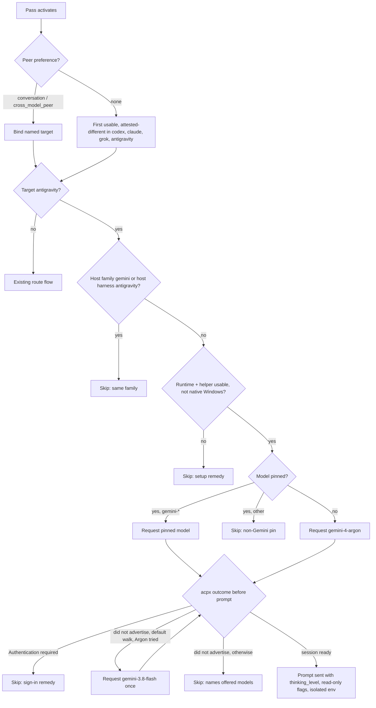

# Antigravity Cross-Model Peer - Plan

## Goal Capsule

- **Objective:** A user who has Google Antigravity set up gets a Gemini second opinion in code review, doc review, pov panels, and `ce-work`, served by the best Gemini model their subscription offers, whenever they name it or no higher-ranked peer is available. When it cannot run, nothing is sent and the user is told why.
- **Means:** an `antigravity` route on the pinned acpx transport's built-in `antigravity` agent (KTD1), with a worker-side Argon-then-Flash walk in the review and pov workers (KTD2) and two exact candidates in `ce-work` (KTD3).
- **Authority:** Product Contract requirements win on behavior; KTDs win on mechanism within them; units override neither. Repo rules in `AGENTS.md` and the three `CODING_STANDARDS.md` files apply, and every edit under `skills/**` goes through the repo-local `ce-skill-work` skill first.
- **Stop conditions:** stop and report before continuing if the U1 isolation probe, run with a scratch `HOME` and `GEMINI_HOME`, shows any of the following. Each result invalidates R10 as planned.
  - The runtime reads the user's `~/.gemini` plugins, skills, or settings.
  - It writes conversation, history, brain, or knowledge content outside the per-run scratch directories. Runtime binary caches such as the encoder under `~/.gemini/antigravity/bin` do not count.
  - A user already signed in to Antigravity cannot sign in under the isolation that prevents both.

  A user who simply has not signed in is not a stop: that is the sign-in skip (KTD6).
- **Execution profile:** shell worker scripts, Python controller, markdown references, docs, and Bun tests. The duplicated transport and kernel blocks change in one canonical copy and propagate mechanically (KTD7).
- **Finishing:** `ce-work` implements and verifies; `ce-commit-push-pr` ships. GitHub issue #1798 is the tracking issue.

---

## Product Contract

### Summary

Add `antigravity` as a cross-model peer in `ce-code-review`, `ce-doc-review`, `ce-pov`, and `ce-work`. The automatic peer order becomes `codex -> claude -> grok -> antigravity`, and Composer leaves the automatic order. The route prefers `gemini-4-argon`, falls back to `gemini-3.8-flash` when the account does not offer Argon, runs only Gemini models, and skips with a stated reason when it cannot run.

### Problem Frame

The plugin's cross-model passes have no supported Gemini peer. The only path today is Cursor attesting a Gemini serving family, and the user guides say so ("Gemini has no standalone target"). Google has moved individual Gemini users from Gemini CLI to Antigravity: Gemini CLI's personal sign-in is now refused with `UNSUPPORTED_CLIENT` and a message to migrate to Antigravity (google-gemini/gemini-cli#28846). Gemini 4 Argon shipped on 2026-10-14 to higher subscription tiers, and access is expected to widen. Issue #1798 requests the route.

The acpx transport now on `main` gives a direct path. acpx 0.19.4 has a built-in `antigravity` agent that launches Google's official ACP runtime (`agy_acp_server.par` plus its `localharness_external` helper). That runtime is a separate download from the `agy` CLI. Live probes on macOS with runtime 1.4.0 showed it reuses the existing Google sign-in, honors read-only permission denial, refuses unadvertised models before any prompt is sent, and offers only the models the account is entitled to.

### Requirements

**Peer selection**

- R1. `antigravity` is a selectable peer target in `ce-code-review`, `ce-doc-review`, `ce-pov`, and `ce-work`, chosen by a conversation request, `cross_model_peer`, or a `work_engine_preferences` entry.
- R2. Automatic peer selection in `ce-code-review`, `ce-doc-review`, and `ce-pov` uses `codex -> claude -> grok -> antigravity`. Composer is no longer chosen automatically but remains valid when named or configured.
- R3. A session hosted on a Gemini model or on Antigravity never selects `antigravity` as its peer.
- R4. `ce-work` uses Antigravity only when the user or configuration selects it, as with every other engine today.

**Model and effort**

- R5. With no model pinned, the route uses `gemini-4-argon` when the account offers it and otherwise `gemini-3.8-flash`, decided before any content is sent. The run log names the model used and says when it was a fallback.
- R6. A pinned model (`cross_model_model`, a `work_engine_preferences` model, or one named in conversation) runs exactly or the pass skips with a named reason. It must be a `gemini-*` id.
- R7. The route never runs a non-Gemini model, including the Claude and gpt-oss models Antigravity serves on some accounts.
- R8. Effort maps to Antigravity's thinking level (`low`, `medium`, `high`), defaulting to `high`. A configured effort outside those levels skips the pass with a named reason.

**Safety and isolation**

- R9. In review and pov runs the peer stays read-only: write, edit, and shell actions are denied.
- R10. A peer run never reads the user's own Antigravity or Gemini plugins, skills, settings, or history, never bills a Gemini API key or Google Cloud project, and leaves no reviewed content in the user's Antigravity history.
- R11. A missing runtime or helper, a missing sign-in, an unsupported platform, or no offered Gemini model in the preference list skips the pass before anything is sent, with a reason and a setup remedy.
- R12. The receipt records the served model as unverified, because the runtime reports none.

**Configuration, setup, and docs**

- R13. `antigravity` is a valid value for `cross_model_peer` and the `work_engine_preferences` harness, and takes `low|medium|high` in `cross_model_effort` and `work_engine_effort`. No new config keys.
- R14. `ce-setup`'s health check reports whether the Antigravity runtime and helper are usable when Antigravity is configured or found on PATH, and points to the official download when they are not.
- R15. User guides and configuration docs describe the route, the new automatic order, and setup, and no longer say Gemini has no standalone target.

### Key Decisions

- **Antigravity, not Gemini CLI.** Google refuses Gemini CLI's personal sign-in and directs users to Antigravity. Governs R1. (session-settled: user-approved — chosen over a Gemini CLI route: personal OAuth is rejected server-side, so most users could not use it)
- **Gemini models only.** Antigravity's Claude 4.6 and gpt-oss models are old or rarely used. Governs R6, R7. (session-settled: user-directed — chosen over serving whatever model Antigravity offers: the route exists to add a Gemini voice)
- **Argon first, Flash as fallback.** Subscribers on higher tiers get Gemini 4 now, and lower tiers move up automatically as access widens. Governs R5. (session-settled: user-directed — chosen over shipping Flash only and adding Argon later: users should not wait on a plugin release to get Argon)
- **Antigravity joins the automatic order last; Composer leaves it.** Governs R2. (session-settled: user-directed — chosen over keeping Antigravity opt-in only: installing the separate ACP runtime is already a deliberate opt-in)
- **Extend existing config keys.** A pinned model is exact or skip. Governs R6, R13. (session-settled: user-approved — chosen over a fallback list inside `cross_model_model`: ordered fallback belongs in the separate `cross_model_peer` list follow-up)

### Acceptance Examples

- AE1. Covers R5. **Given** an account whose session offers only `gemini-3.8-flash`, **when** the route runs with no pinned model, **then** acpx refuses `gemini-4-argon` before the prompt, the worker runs once more with `gemini-3.8-flash`, and the log says Flash was used because Argon was not offered.
- AE2. Covers R6, R11. **Given** `cross_model_model: gemini-4-argon` and an account without Argon, **when** the route runs, **then** the pass skips naming the offered models, and Flash never runs.
- AE3. Covers R2. **Given** a Claude-hosted session with Codex and Grok absent and Cursor installed, **when** a review's cross-model pass activates with no preference, **then** Antigravity is selected if usable, and Composer is not selected.
- AE4. Covers R11. **Given** the runtime on PATH but never signed in, **when** the route runs, **then** the pass skips before any prompt with a sign-in remedy.
- AE5. Covers R8. **Given** `cross_model_effort: xhigh` and automatic selection landing on Antigravity, **when** the pass starts, **then** it skips naming `low|medium|high`.

### Scope Boundaries

- Gemini CLI as a peer route is out of scope.
- No new config keys and no fallback lists in `cross_model_model`.
- `ce-pov` gains no new config consumption: it keeps editorial efforts (Antigravity at `high`) and its existing model-override path.
- The plugin does not download or update the Antigravity runtime; `ce-setup` points to the official download.

Considered and not built:

- **Cleaning the runtime's `cacerts__py_binary_resource_*` files from `$TMPDIR`.** They are small, and pointing the runtime's `TMPDIR` at run scratch risks breaking its own resource extraction. Revisit if they are shown to accumulate meaningfully.
- **A separate sign-in probe before dispatch.** An unauthenticated runtime already fails at `session/new`, before any prompt, so the existing pre-egress path covers it without an extra launch.
- **Measured idle floors for the route.** It uses the shared idle and hard deadlines. Revisit if large-diff runs at `high` thinking hit the idle deadline.
- **Accepting `gemini` as a `CROSS_MODEL_PEERS` alias.** The allowlist is an egress restriction, and an alias would widen it implicitly. The skip message names the literal `antigravity` instead (KTD9).

#### Deferred to Follow-Up Work

- `cross_model_peer` as an ordered list (separate PR, already agreed).
- Native Windows support for the route, after a smoke test with `agy_acp_server.exe` (KTD10).
- Enterprise SSO sign-in, which is untested; the `agy` CLI has a reported token-size bug (antigravity-cli#1037) that may or may not affect the ACP runtime.
- A Gemini CLI route for API-key or enterprise users, if requested.

### Sources

- Issue #1798 and its comment on enterprise SSO.
- https://ai.google.dev/gemini-api/docs/models/gemini-4-argon (stable id `gemini-4-argon`, thinking levels low/medium/high).
- ACP registry entry `agentclientprotocol/registry` `antigravity-acp/agent.json` (runtime 1.4.0 download URLs) and the acpx guide `agents/Antigravity.md`.
- google-gemini/gemini-cli#28846 (`UNSUPPORTED_CLIENT` on personal sign-in).

---

## Planning Contract

### Key Technical Decisions

- KTD1. **Use acpx's built-in `antigravity` agent.** It launches the official ACP runtime and gets the shared transport's outcome parsing, permission flags, and pre-egress handling. The `agy` CLI's print mode needed the prompt in argv (128 KiB limit), ignored `--mode plan` under `--disable-slash-commands`, and has no ACP mode. Governs R1.
- KTD2. **Review and pov workers resolve the default model with a one-step walk.** The worker requests `gemini-4-argon`; when acpx ends before the prompt with evidence containing "did not advertise", it runs once more with `gemini-3.8-flash`, and otherwise reports that outcome. The selected model is cached for the run so the pov non-final retry reuses it. For Antigravity this walk is the route's preferred mapping, and the host-side "closest same-family replacement" step in the review references does not apply. Rejected: a probe session that parses `configOptions[id=model]`, which adds a launch and acpx usage nothing else relies on. Implements the Argon-first Key Decision; governs R5.
- KTD3. **`ce-work` expresses the default as two exact candidates, settled at preflight.** An `antigravity` candidate with no model normalizes to `gemini-4-argon` then `gemini-3.8-flash`. The existing traversal only moves between candidates before `init`; once `init` returns `READY` the engine decision is closed, and the plain `--emit-adapter` preflight never launches the runtime. So the antigravity preflight adds a model-availability check: it launches the runtime, asks for the candidate model, and ends before any prompt is sent. An unadvertised Argon disqualifies that candidate there, and traversal binds Flash at `init`. The controller pins the receipt's `model_requested` to the authorization (`skills/ce-work/scripts/unit_workspace_jobs.py`), so an in-worker walk would fail as a mismatch, and `auto` would drop `--model` and could serve a non-Gemini model. Rejected: a sentinel default plus a new receipt field, which changes a stored format, and re-initializing a run after an unavailable receipt, which needs a new controller path to close a run without claiming fallback. Governs R5, R7.
- KTD4. **Serving family `gemini`; independence follows the route family.** `target_serving_family antigravity` returns `gemini`, the host serving-family vocabulary gains `gemini`, and the host-harness vocabulary gains `antigravity`. Candidate filtering excludes target `antigravity` when the host family is `gemini` or the host harness is `antigravity`; the harness check is new, since today workers exclude by family alone. `model_actual` stays `unverified`. Independence is credited by route family as for `codex` and `claude`, not set to `unknown` as for Cursor default: the worker always requests an explicit `gemini-*` id, the vendor's own runtime must advertise it before the prompt is sent, and the remaining risk is server-side substitution, the same as for the other vendor CLIs. This also turns on cross-model review for Gemini-hosted sessions, which were previously skipped as an unknown family. Governs R3, R12.
- KTD5. **Peer isolation lives in the route's launch environment.** The antigravity branch of `acpx_base_argv`:
  1. unsets an explicit list of Google credential variables: `GEMINI_API_KEY`, `GOOGLE_API_KEY`, `GOOGLE_APPLICATION_CREDENTIALS`, `GOOGLE_CLOUD_PROJECT`, `GOOGLE_CLOUD_LOCATION`, `GOOGLE_GENAI_USE_VERTEXAI`, and `AGY_LLM_GATEWAY_URL`. `env -u` takes no wildcards and must come before the first assignment, so the shared `env` line is restructured.
  2. sets `GEMINI_HOME` to a per-run scratch directory whose `antigravity-acp/settings.json` selects `oauth-personal`.
  3. sets `ANTIGRAVITY_HARNESS_PATH` to the helper beside the runtime when the variable is unset; an explicit value wins.

  `ce-work`'s `env -i` allowlist forwards the same three settings. When the U1 probe shows session state written under the real home, every worker also sets `HOME` to run scratch for this route. Governs R10.
- KTD6. **Failures before egress are route skips with remedies.** The following are route-scoped pre-egress outcomes: runtime not on PATH, helper missing, native Windows, `Authentication required` at `session/new`, and no offered model in the preference list. The skip reason carries a remedy pointing at `ce-setup` or at signing in to Antigravity. A run that reaches the prompt follows the existing launched-failure rules. Governs R11.
- KTD7. **`ce-code-review`'s worker is the canonical copy.** The acpx transport block is edited there and copied byte-for-byte into the other three workers. The route-table and validator kernel is copied into `ce-doc-review`. `ce-pov` and `ce-work` carry their own deliberate variants. The parity tests prove the copies match, and the PR description names the canonical copy so reviewers do not suggest extracting a shared module.
- KTD8. **Effort is the `thinking_level` session option.** Review workers pass `--config-option thinking_level=<effort>`, default `high`, honoring `cross_model_effort` within `low|medium|high`. `ce-pov` hardcodes `high`. `ce-work` honors `work_engine_effort.antigravity`. Governs R8.
- KTD9. **"Gemini" in conversation means `antigravity`.** References tell the host that a request for a Gemini peer binds target `antigravity`. `CROSS_MODEL_PEERS` must list the literal `antigravity`, and its skip message names that token. Governs R1.
- KTD10. **Native Windows is a named unavailable.** Preflight reports the route unavailable on native Windows until `agy_acp_server.exe` is smoke-tested with `tests/windows/acpx-worker-smoke.sh`. Governs R11.

### High-Level Technical Design

Route selection and model resolution, from the cross-model pass activating to the prompt being sent:

`ce-work` reaches the same Argon-then-Flash result through two consecutive exact candidates (KTD3), not an in-worker walk.

### Assumptions

- The acpx 0.19.4 error text "did not advertise that model" is stable for the pinned version; the acpx contract suite pins it (U1).
- `gemini-4-argon` will appear in `configOptions[id=model]` under that bare id for entitled accounts, matching Google's documented stable id.

### Risks & Dependencies

| Risk | Mitigation |
|---|---|
| The runtime writes under `$HOME/.gemini` even with `GEMINI_HOME` set (an encoder binary appeared in `~/.gemini/antigravity/bin` during a probe that used a scratch `GEMINI_HOME`). | U1 probes with a scratch `HOME` and records what is read and written. If session state lands under the real home, both the review workers and `ce-work` point `HOME` at run scratch for this route; the Goal Capsule stop conditions decide when that is not enough. |
| Keychain sign-in may fail under `ce-work`'s `env -i` or a scratch `HOME`. | Probe in U1 and U5. For a signed-in user this is a Goal Capsule stop condition, never a fallback to the real home; at runtime an unauthenticated session is the sign-in skip. |
| An acpx pin bump changes the unadvertised-model or auth error shape. | Contract fixtures in U1 fail on a bump; `scripts/bump-acpx-pin.ts` runs the contract suite. |
| Removing Composer from the automatic order changes the peer for users whose only usable peer was Composer. | Documented in the guides; Composer stays available when named or configured. |
| Antigravity's account-dependent model list differs from `agy models`. | The walk depends only on what the ACP session advertises, never on the CLI's list. |

### Sequencing

U1 first, because every route branch and the `ce-work` environment depend on the transport block and the probe results. U2 follows. U3, U4, and U5 can then proceed in parallel. U6 can run alongside U3 to U5. Live evals in the Verification Contract run last.

---

## Implementation Units

### U1. Shared acpx transport: antigravity agent, isolation, preflight

- **Goal:** Give all four workers a byte-identical transport that launches Antigravity in isolation and classifies its pre-egress failures.
- **Requirements:** R7, R10, R11; KTD1, KTD5, KTD6, KTD7, KTD10.
- **Dependencies:** none.
- **Files:**
  - `skills/ce-code-review/scripts/cross-model-adversarial-review.sh` (canonical)
  - `skills/ce-doc-review/scripts/cross-model-doc-review.sh`
  - `skills/ce-pov/scripts/cross-model-pov.sh`
  - `skills/ce-work/scripts/cross-model-work.sh`
  - `tests/acpx-transport-parity.test.ts`
  - `tests/acpx-contract.test.ts`
  - `tests/fixtures/acp-stub-agent.mjs`
  - `tests/fixtures/acpx-streams/auth-required.stdout`, `auth-required.exit` (new)
- **Approach:**
  1. Before editing, run three live probes with the runtime and record the outcomes as dated observations in the PR:
     - a scratch `HOME` plus scratch `GEMINI_HOME`, diffing what the runtime reads and writes;
     - `env -i` with `ce-work`'s allowlist plus `--approve-all` and a candidate write mode;
     - a bogus `GEMINI_API_KEY`, to confirm stripping matters.

     Apply the Goal Capsule stop condition to the first.
  2. Map route `antigravity` to acpx agent `antigravity` in `acpx_agent`.
  3. Restructure `acpx_base_argv` so route-specific `-u` flags follow `env` directly, and add the antigravity environment per KTD5 with the per-run scratch path passed in as an argument.
  4. Extend preflight per KTD6 and KTD10. Locate the runtime by its platform name and check the helper, defaulting it from the runtime's directory.
  5. Let `acpx_failure_evidence` surface `Authentication required` as its own evidence string so workers can attach the sign-in remedy.
  6. Add an auth-required mode to the ACP stub agent and a contract case pinning acpx's exit and no-prompt shape for it, next to the existing unknown-model case.
  7. Copy the block into the other three workers.
- **Execution note:** Probe before editing; the probe results can change step 3.
- **Patterns to follow:** the opencode per-route `env` prefix in `adapter_argv`; `CODEX_PATH` / `CLAUDE_CODE_EXECUTABLE` in `acpx_base_argv`; `tests/fixtures/acpx-streams/unknown-model.*`.
- **Test scenarios:**
  - The transport parity test passes with the antigravity mapping present in all four workers.
  - With the stub agent in auth mode, real acpx exits without a `session/prompt` request and the stream carries "Authentication required" (contract suite).
  - The unknown-model contract case still passes with the restructured `env` line.
  - `--emit-adapter antigravity` argv starts with `env`, then the `-u` flags, then assignments including `GEMINI_HOME`, and contains no `GEMINI_API_KEY` assignment.
- **Verification:** the parity test is green, the contract suite is green under `ACPX_CONTRACT=1`, and probe observations are recorded.

### U2. Review workers: antigravity route, model walk, family

- **Goal:** `ce-code-review` and `ce-doc-review` can run Antigravity as a peer, chosen automatically or by name, with the Argon-then-Flash walk.
- **Requirements:** R1, R3, R5, R6, R7, R8, R9, R11, R12; KTD2, KTD4, KTD6, KTD8.
- **Dependencies:** U1.
- **Files:**
  - `skills/ce-code-review/scripts/cross-model-adversarial-review.sh`
  - `skills/ce-doc-review/scripts/cross-model-doc-review.sh`
  - `tests/skills/ce-code-review-cross-model-routes.test.ts`
  - `tests/skills/ce-doc-review-cross-model-routes.test.ts`
  - `tests/cross-model-receipt-parity.test.ts`
- **Approach:**
  1. In the route tables, add the target, harness, family `gemini`, availability, the preference constants, and effort per KTD8, plus model validation accepting only `gemini-*` and effort validation accepting `low|medium|high`.
  2. Add `gemini` to host-family validation, `antigravity` to host-harness validation, the known targets, and `provider_available`, and add the KTD4 harness exclusion beside the same-family exclusion.
  3. Add `adapter_argv` options: `mode=default` with the existing deny flags (verified live to deny writes) and `thinking_level`.
  4. Implement the KTD2 walk once per run, outside `attempt_route`.
  5. Return false from `route_receipt_supported`.
  6. Leave the receipt kernel untouched unless independence normalization needs an antigravity arm, and keep it identical across the three review workers.
  7. Update the header example order strings.
  8. Copy the kernel block from code-review to doc-review.
- **Patterns to follow:** the composer and grok-cursor rows in each table; the unknown-model `not-sent` handling in `attempt_route`; `streamSequence()` in the route tests.
- **Test scenarios:**
  - Covers AE1. The first stub call returns an unknown-model stream for `gemini-4-argon` and the second call ends normally: argv for call 2 carries `--model gemini-3.8-flash`, and the log names the fallback.
  - Covers AE2. A pinned `gemini-4-argon` with an unknown-model stream skips naming the offered models, with exactly one acpx call.
  - A pinned `claude-sonnet-4-6` for target antigravity skips as non-Gemini before any acpx call.
  - Covers AE5. Effort `xhigh` for antigravity skips before any acpx call; `medium` passes `thinking_level=medium`.
  - Covers AE4. An auth-required stream skips as route pre-egress with the sign-in remedy, and no prompt file is sent.
  - A host family `gemini` with candidates ending in `antigravity` excludes antigravity as same-family.
  - A host family `claude` with host harness `antigravity` also excludes antigravity.
  - Covers AE3. Candidates `codex,claude,grok,antigravity` with only the antigravity runtime present select antigravity, and composer is not in the passed order.
  - The child environment logged by the npx stub has no `GEMINI_API_KEY` and has `GEMINI_HOME` pointing at run scratch with `oauth-personal` settings.
  - The receipt shows `model_actual` unverified, independence follows KTD4, and the requested model is the one actually requested on the final attempt.
  - The route-safety `test.each` covers antigravity and `NEVER_FLAGS` holds.
- **Verification:** both route test files and the kernel parity test pass; `--emit-adapter antigravity` matches between the two workers.

### U3. Review references and guides: order, naming, vocabulary

- **Goal:** The hosts running `ce-code-review` and `ce-doc-review` select peers by the new order and describe Antigravity correctly.
- **Requirements:** R2, R3, R9, R15; KTD2, KTD4, KTD9.
- **Dependencies:** U2.
- **Files:**
  - `skills/ce-code-review/references/cross-model-review.md`
  - `skills/ce-doc-review/references/cross-model-review.md`
  - `docs/guides/ce-code-review.md`
  - `docs/guides/ce-doc-review.md`
  - `tests/skill-eval-cell/packs/ce-code-review-cross-model.md`
  - `tests/skill-eval-cell/packs/ce-doc-review-cross-model.md`
- **Approach:**
  1. Change the default order line to `codex -> claude -> grok -> antigravity`, and state that Composer, like Cursor default, runs only when named or configured.
  2. Add the `antigravity` row to the route-token table.
  3. Add `gemini` and `antigravity` to the host family and harness vocabularies in the attestation snippets.
  4. State the KTD2 exception to host-side model replacement and the KTD9 naming rule.
  5. Replace the guides' "Gemini has no standalone target" text with a short description of the route, its setup, and the new order.
  6. Add the eval scenarios listed in the Verification Contract to both packs.

  Restate the touched blocks to the current skill standard via `ce-skill-work` instead of appending cases.
- **Test scenarios:** `bun run test:skill-guards` passes, including `tests/skills/cross-model-review-mode.test.ts` and the SKILL.md byte budget, since no SKILL.md grows.
- **Verification:** both references name one order, the route table, and the vocabulary consistently; the behavioral evals in the Verification Contract pass.

### U4. ce-pov: route, family, declared order

- **Goal:** pov panels can include Antigravity, select it automatically after Codex, Claude, and Grok, and treat it as family `gemini`.
- **Requirements:** R1, R2, R3, R5, R6, R7, R9, R12, R15; KTD2, KTD4, KTD8.
- **Dependencies:** U1, U2.
- **Files:**
  - `skills/ce-pov/scripts/cross-model-pov.sh`
  - `skills/ce-pov/references/cross-model-panel.md`
  - `docs/guides/ce-pov.md`
  - `tests/skills/ce-pov-cross-model-routes.test.ts`
- **Approach:**
  1. Add route tables, the fixed-route token, model validation in `apply_model_override` (`gemini-*` only), the `adapter_argv` options with `thinking_level=high`, and the KTD2 walk cached across the non-final retry.
  2. Change the independence calculation, which currently returns the target name, so antigravity reports family `gemini`, and apply the KTD4 family and harness exclusions to pov's peer selection.
  3. In the panel reference, declare the default order `codex -> claude -> grok -> antigravity` where it currently cites an undeclared "declared default order", and add the vocabulary and naming rules.
  4. Add the target table row and prerequisites in the guide.
- **Patterns to follow:** U2's route rows; pov's existing non-final retry at `attempt_route`.
- **Test scenarios:**
  - Argon is unadvertised and the Flash call returns a non-final position: the retry reuses `gemini-3.8-flash` without a new Argon attempt.
  - A Gemini host excludes antigravity, and so does an Antigravity-harness host serving another family.
  - A pinned non-Gemini model skips before acpx.
  - A stub stream carries the required `final` field, and the panel record shows family `gemini` with `model_actual` unverified.
- **Verification:** the pov route test file passes; the panel reference declares the order exactly once.

### U5. ce-work: antigravity engine

- **Goal:** `ce-work` can run implementation units on Antigravity when configured or named, with the Argon-then-Flash default as two candidates.
- **Requirements:** R1, R4, R5, R6, R7, R8, R10, R11, R13; KTD3, KTD5, KTD8.
- **Dependencies:** U1.
- **Files:**
  - `skills/ce-work/scripts/cross-model-work.sh`
  - `skills/ce-work/scripts/unit_workspace_state.py`
  - `skills/ce-work/references/cross-model-execution.md`
  - `skills/ce-work/references/execution-engines.md`
  - `skills/ce-work/references/input-triage.md`
  - `skills/lfg/references/stage-routing.md`
  - `docs/guides/ce-work.md`
  - `tests/skills/ce-work-cross-model-routes.test.ts`
  - `tests/skills/helpers/ce-work-acp-stub.ts`
  - `tests/skills/ce-work-outcome-spine.test.ts`
  - `tests/skills/ce-work-unit-workspace-init.test.ts`
- **Approach:**
  1. Add `ROUTE_CONTRACTS["antigravity"]`: target and harness `antigravity`, no intermediaries, `default_model` `gemini-4-argon`, cooperative posture. Append it so the generated route list keeps its order.
  2. Add a `gemini-*` branch to `route_model_allowed`, and mirror both in the worker's embedded `contracts`/`model_allowed` and its shell validators, so all three model-family validators agree.
  3. Add the `MIN_ENV` antigravity case forwarding the KTD5 settings.
  4. Add `adapter_argv` with the write mode chosen from the U1 probe and `thinking_level`.
  5. Add the KTD3 preflight model-availability check for antigravity candidates. It runs before `init`, launches the runtime, and ends before any prompt is sent. An unadvertised model marks the candidate unavailable so traversal continues.
  6. In `cross-model-execution.md`, add the target, the route token, the limits-table row, the KTD3 normalization rule (an Antigravity candidate with no model becomes two exact candidates), and the preflight check.
  7. Add `antigravity` to the target enums in `input-triage.md` and lfg's `stage-routing.md`.
  8. Treat a cancelled Antigravity interaction request as a launched failure.
- **Execution note:** Confirm the write mode, keychain sign-in under `env -i`, and an acpx path that validates a model without sending a prompt, all live, before writing the adapter case.
- **Patterns to follow:** the `cursor`/`composer` contract rows and `MIN_ENV` per-route cases; the existing unknown-model receipt case in the route tests.
- **Test scenarios:**
  - Covers AE1. With no model configured and a stub session that offers only Flash, preflight disqualifies the Argon candidate without sending a prompt, `init` binds `gemini-3.8-flash`, the run reaches `end_turn`, and no fallback claim is recorded.
  - An authorization with `antigravity` and `gemini-4-argon` produces an unknown-model receipt `transport unavailable (pre-egress, route)` with exit 2, and nothing is sent.
  - An authorization with `antigravity` and `gemini-3.8-flash` runs to `end_turn`, and the receipt's `model_requested` matches the authorization.
  - A non-Gemini model in an antigravity authorization is rejected identically by the controller and the worker.
  - The `env -i` child has `GEMINI_HOME` and `ANTIGRAVITY_HARNESS_PATH` and no `GEMINI_API_KEY`.
  - `work_engine_effort.antigravity: xhigh` makes the candidate unavailable before egress.
  - The init error text and outcome-spine prose pins include `antigravity`.
- **Verification:** the ce-work route, integration, init, and outcome-spine tests pass; a live `ce-work` unit on Antigravity in the eval run shows the expected candidate traversal.

### U6. Config, ce-setup health check, and configuration docs

- **Goal:** Users can configure Antigravity with existing keys and see whether its runtime is usable.
- **Requirements:** R13, R14, R15.
- **Dependencies:** U2 (for the effort vocabulary).
- **Files:**
  - `skills/ce-setup/references/config-template.yaml`
  - `.compound-engineering/config.example.yaml`
  - `docs/guides/configuration.md`
  - `skills/ce-setup/scripts/check-health`
  - `skills/ce-setup/references/acpx-cache-warm.md` (only if its peer wording needs it)
  - `docs/guides/ce-setup.md`
  - `tests/skills/ce-setup-check-health.test.ts`
- **Approach:**
  1. Add `antigravity` to the `cross_model_peer` comment enum, the effort-level line, and the `work_engine_preferences` harness list in the template, then copy it byte-for-byte to the example.
  2. Update `configuration.md`'s peer, effort, and harness descriptions, plus the new automatic order and Composer's change.
  3. In `check-health`, accept `antigravity` in the `work_engine_preferences` harness and `work_engine_effort` key validation, with values `low|medium|high`.
  4. Add a report line: when Antigravity is configured or the runtime is found on PATH, report whether the runtime and helper are usable, and point to the ACP registry download when they are not. Say nothing otherwise.
- **Test scenarios:**
  - `work_engine_preferences: [{harness: antigravity}]` validates clean.
  - `work_engine_effort: {antigravity: xhigh}` warns with the allowed levels.
  - Configured antigravity with no runtime on PATH reports the missing runtime and the download pointer.
  - The runtime on PATH with no helper reports the missing helper.
  - Neither configured nor installed produces no antigravity line.
  - The template and example remain byte-identical.
- **Verification:** the check-health tests pass; `bun run release:validate` passes.

---

## Verification Contract

| Gate | Applies to | Done signal |
|---|---|---|
| `bun run test:skill-guards` | every `skills/**` edit | green, including the SKILL.md byte budget |
| `bun run test` | all units | green |
| `bun run typecheck` | U1, U2, U5, U6 test edits | green |
| `ACPX_CONTRACT=1 bun run test:acpx-contract` | U1 (stub agent and contract cases) | green on the pinned acpx |
| `bun run release:validate` and `bun run plugin:validate` | U6 and reference edits | green |
| Live probes | U1, U5 | dated observations recorded in the PR: isolation, `env -i` write mode, API-key stripping |
| Live A/B evals with real dispatch | U3, U4, U5 | `bun run test:skill-eval-pack -- --skill <name> --arm ab` for `ce-code-review`, `ce-doc-review`, `ce-pov`, and `ce-work`, on Claude and Codex hosts, graded on artifacts |

Eval scenarios to add to the packs:

- The automatic pass picks Antigravity when it is the only usable peer.
- Restraint: Antigravity not installed, so the pass picks the next peer or none and never mentions a Gemini fallback.
- Restraint: Composer installed but not named, so it is not auto-selected.
- Composer named, so it runs.
- "Use Gemini for the cross-model pass" binds `antigravity`.
- A Gemini review returns real findings, not just `end_turn`.
- A pov panel run returns a final position from Gemini.

## Definition of Done

- Every requirement R1 to R15 is met, and each acceptance example has a passing test.
- All gates in the Verification Contract pass, and probe observations and eval results are recorded in the PR.
- The duplicated blocks match their canonical copy, and the PR names the canonical copy.
- No SKILL.md exceeds its byte budget, and no SKILL.md gained peer vocabulary.
- Abandoned attempts and probe scaffolding are removed from the diff.
- If the work produced durable reasoning not recoverable from the final code (for example the probe results on runtime isolation), `ce-compound` captures it under `docs/solutions/`.
