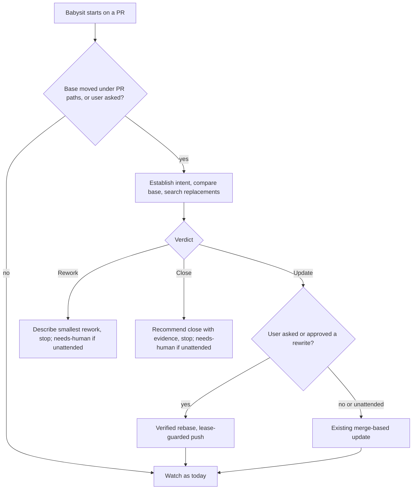
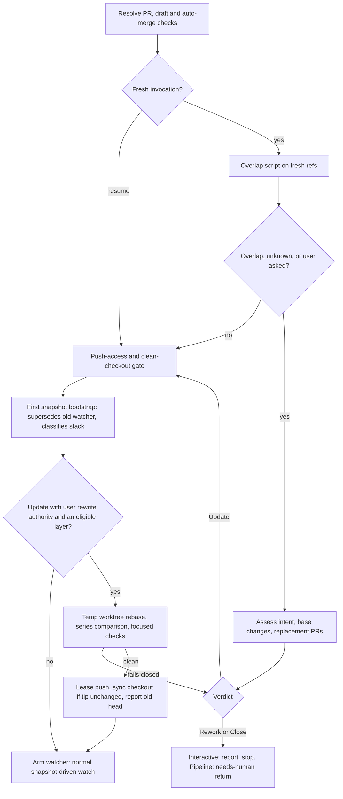

# Babysit Stale PR Intake Check - Plan

## Goal Capsule

- **Objective:** Whoever carries an open PR that has fallen behind its base learns, with evidence and before anything is pushed, whether it should still exist; a PR worth keeping is brought up to date with its intent and its contributors' credit intact.
- **Means:** an intake check inside `ce-babysit-pr`, plus a takeover path for continuing someone else's PR in a replacement PR.
- **Product authority:** this Product Contract. One named PR per run; backlog triage is not in scope.
- **Open blockers:** none. Takeover's credit requirement (R24) depends on contributor-credit handling another thread is adding to `ce-commit-push-pr`; KTD9 records the ordering.
- **Execution profile:** skill prose and one bundled script inside `skills/ce-babysit-pr/`, contract and script tests, user docs, and a hand-run behavioral eval pack. Skill edits go through the repo-local `ce-skill-work` skill.
- **Stop conditions:** stop and report if a session-settled decision proves unworkable, if the babysit body cannot fit its 8,000-byte budget after moving a block to a reference, or if an existing contract pin must be deleted rather than restated.
- **Finishes and ships:** `lfg` on branch `feat/stale-pr-refresh`, shipped through `ce-commit-push-pr`; the user merges.

---

## Product Contract

### Summary

`ce-babysit-pr` gains an intake check. When main has moved under a PR's paths, or the user asks, babysit works out what the PR was for and what changed on its base since it branched off, then gives one verdict: Update, Rework, or Close. Update leads to a verified rebase when the user asked for one or approved it, and otherwise to babysit's existing merge-based update, then normal watching; Rework and Close report evidence and stop. On request, babysit can also carry a PR forward in a replacement PR that keeps its contributors' commits and credit.

### Problem Frame

An agent asked to update an old PR rebases it, and when git reports no conflicts it pushes. Git only reports textual conflicts. It says nothing about whether the base already solved the same problem, deleted the code the PR changes, or moved the responsibility elsewhere.

This repo has a live case. Open PR #342 adds `plugins/compound-engineering/agents/review/redundancy-reviewer.md`. Since then the plugin moved to the repo root and stopped shipping standalone agents; reviewer personas now live inside skills. Rebasing #342 produces no conflict, and merging it recreates a directory the project deliberately removed.

The existing skills do not catch this. `ce-babysit-pr` brings a branch current only by merging the base in when its snapshot flags the PR behind or conflicting, and it never rebases or force-pushes (`skills/ce-babysit-pr/references/branch-currency.md`). A clean merge then reads as merge-ready. `ce-commit-push-pr`'s guide sends history rewrites to the user to do by hand. No skill asks whether an old PR should still exist, verifies that a rebase kept the PR's intended changes and brought nothing back, or continues a contributor's stalled PR while keeping their credit.

### Key Decisions

- **The capability lives in `ce-babysit-pr`, not a new skill.** Babysit's goal is merge-ready, and a PR that should no longer exist can never truthfully reach it, so the check belongs at the start of that goal. Governs R1, R10. (session-settled: user-directed — chosen over a separate skill that hands off to babysit, and over a judgment-only check that never rebases: a separate skill was judged unnecessary for a job babysit's goal already implies.)
- **One named PR per run.** Governs R1. (session-settled: user-directed — chosen over a backlog sweep across all open PRs: no one asked for backlog triage.)
- **The check runs on path overlap or on request.** Governs R1, R2, R3. (session-settled: user-directed — chosen over running only when asked, which misses #342-style cases, and over every run, which charges every fresh PR.)
- **History-rewrite authority depends on how the check started.** Governs R15, R30. (session-settled: user-directed — chosen over always asking and over never asking.)
- **Unattended runs check quietly.** Unattended runs are where no one else would notice that a sibling PR already solved the problem. Governs R4, R30. (session-settled: user-directed — chosen over limiting the automatic check to interactive runs: the cost of a quiet Update verdict is time, not interruption.)
- **Takeover is in scope.** It answers the case babysit currently stops on, a PR it cannot push to. Governs R23-R28. (session-settled: user-directed — chosen over in-place updates only, with takeover deferred.)
- **Verdict names are Update, Rework, and Close.** They are plain verbs for what happens next, and "Update" names the outcome rather than the git mechanism. Governs R10. (session-settled: user-directed — chosen over Current / Reshape / Retire and Still fits / Needs rework / Superseded.)
- **Babysit's no-rebase rule narrows rather than disappears.** R8 of `docs/plans/2026-07-18-001-fix-babysit-moving-base-plan.md` still governs automatic branch-currency maintenance; history rewrite is a separate, user-authorized step outside the snapshot-driven loop. Governs R15.
- **Rework is not implemented by babysit itself.** Babysit hands requested rework to `ce-work`, the way it already hands CI failures to `ce-debug`. Governs R13.

### Actors

- A1. The user running babysit interactively: a maintainer reviving an old PR, or someone continuing another contributor's PR.
- A2. An unattended caller such as `lfg` running babysit in `mode:pipeline`.
- A3. The original PR author, whose credit and branch are at stake.

### Requirements

**Trigger**

- R1. The intake check runs on a single named PR when the base has changed, moved, or deleted any file or directory the PR touches since the PR branched off, or when the user asks to update or rebase the PR or asks whether it is still worth keeping.
- R2. Age, commits behind, and time since last activity never trigger the check on their own and never count as evidence for a verdict.
- R3. A PR with no overlap and no request skips the check; babysit behaves as it does today.
- R4. Unattended runs apply the same trigger as interactive runs.

**Assessment**

- R5. The check establishes the PR's intent from its title, body, linked issues, commits, review threads, and full diff, and states the smallest goal it was trying to reach before judging its implementation.
- R6. The check compares the base's changes since the PR branched off against that goal. It looks for the problem already being solved, the touched code being moved, deleted, or deliberately simplified, changed APIs or ownership boundaries, landing that would restore old behavior or create a second way to do one thing, and a benefit no longer worth its maintenance cost.
- R7. The check searches merged and open PRs for a replacement or competing implementation.
- R8. A clean merge or rebase is never evidence that a PR is current.
- R9. The check works from a freshly fetched base and PR head, not local refs.

**Verdict**

- R10. The check ends in exactly one verdict. Update means the goal is still useful and the implementation is the right shape. Rework means the goal is useful but a mechanical update would keep the wrong implementation. Close means the PR is superseded, obsolete, directionally wrong, or not worth its cost.
- R11. The verdict is reached before anything is pushed.
- R12. Sunk effort is never a reason to keep a PR.
- R13. On Rework, babysit describes the smallest credible rework and stops. If the user then asks for the rework, babysit hands it to `ce-work` and resumes watching the result.
- R14. On Close, babysit recommends closing with cited evidence and stops. It closes only with explicit permission, and that permission covers posting a closing comment that carries the evidence and thanks the contributor.

**Update**

- R15. A history rewrite happens only when the user asked to update or rebase the PR, or approved the rewrite when a self-triggered check asked once. Otherwise, and in every unattended run, an Update verdict continues with babysit's existing merge-based branch-currency handling.
- R16. Conflicts are resolved by the PR's intent and the base's newer invariants. A conflict that reveals a product or architecture disagreement stops the rebase and reopens the verdict.
- R17. Before pushing, the pre-rebase and post-rebase commit series and the final diff are compared, confirming that no intended behavior disappeared and no already-landed behavior came back.
- R18. Focused checks run for the touched area, and the report separates real failures from pre-existing or infrastructure ones.
- R19. The push succeeds only if the remote head still matches the SHA observed before the rebase. On a mismatch, babysit refetches and reassesses and never overwrites.
- R20. Original commit authorship survives the rebase.
- R21. Uncommitted changes in the user's checkout belong to the user and are never discarded or overwritten.
- R22. After a successful update, babysit continues its normal watch under the run's posture.

**Takeover**

- R23. On request, babysit continues a PR in a replacement PR: the original commits carry over to a new branch, and its own changes land as separate commits.
- R24. Contributor credit in the replacement PR comes from `ce-commit-push-pr`'s contributor-credit handling and is not reimplemented here.
- R25. Takeover brings the continuation up to date through the same assessment and update rules (R5-R21).
- R26. Before finishing, takeover rechecks the source PR for new commits or feedback since it started.
- R27. The original PR is closed only with explicit permission.
- R28. Once the replacement PR is open, babysit watches it in place of the original.

**Report**

- R29. The report leads with the verdict and a one-line reason. It then gives the base's meaningful changes, the conceptual conflicts found or a statement that none were, the rebase and push result if any, checks run, the remaining decision, and the PR link. Observed facts stay apart from judgment, and anything unverified is named.
- R30. In unattended runs, an Update verdict continues quietly with existing handling, and a Rework or Close verdict returns as a needs-human item carrying the R29 evidence.

### Key Flows

- F1. Intake to verdict
  - **Trigger:** babysit starts on a PR and R1's condition holds.
  - **Actors:** A1 or A2
  - **Steps:** establish intent; compare base changes and search for replacements; give one verdict; branch per verdict.
  - **Outcome:** Update proceeds to F2 or to existing merge-based handling; Rework and Close report and stop, or return needs-human when unattended.
  - **Covered by:** R1-R14, R29, R30
- F2. Verified update
  - **Trigger:** Update verdict with history-rewrite authority per R15.
  - **Actors:** A1
  - **Steps:** record the head SHA; rebase onto the fresh base; resolve by intent; compare series and diff; run focused checks; push against the recorded head; resume watching.
  - **Outcome:** an up-to-date PR with its intent intact, or a reopened verdict.
  - **Covered by:** R15-R22
- F3. Takeover
  - **Trigger:** the user asks babysit to take a PR over.
  - **Actors:** A1, A3
  - **Steps:** carry the original commits to a new branch; run F1 and F2 against the continuation; recheck the source PR; open the replacement PR with credit; watch it.
  - **Outcome:** a replacement PR under watch with the original contributors credited; the original stays open unless the user permits closing.
  - **Covered by:** R23-R28

### Acceptance Examples

- AE1. **Covers R1, R8, R10, R14.** Given PR #342 adds a file under a directory the base has since removed, when babysit starts on it, the check triggers even though no file the PR touches was edited on the base, and the verdict is Close, citing the move to skill-local personas, with no rebase attempted.
- AE2. **Covers R1, R15.** Given an interactive run where the check triggered on overlap and reached Update, when the user has not asked to update, babysit asks once before rewriting history, and on decline continues with its existing merge-based update.
- AE3. **Covers R4, R30.** Given an `lfg` PR opened an hour ago and a sibling PR merged that touched the same file, when unattended babysit runs, the check runs quietly; an Update verdict continues with existing handling, and a Close verdict citing the sibling PR returns as a needs-human item.
- AE4. **Covers R19.** Given the user asked to update a PR and its author pushed a new commit during the rebase, when babysit pushes, the push is refused, and babysit refetches and reassesses instead of overwriting.
- AE5. **Covers R17.** Given a rebase where conflict resolution silently dropped one of the PR's intended changes, when the series comparison runs, the loss is reported before any push.
- AE6. **Covers R2, R3.** Given a two-year-old PR whose paths the base never touched, when babysit starts without a request, no check runs.
- AE7. **Covers R26.** Given a takeover in progress and the original author pushes a fix to the source PR, when takeover finishes, that fix is noticed and accounted for in the replacement.

### Success Criteria

- Behavioral evals on both Claude and Codex, in throwaway repos with real stale branches (never this checkout), compare babysit before and after the change. Scenarios cover the #342 shape (obsolete add, Close), a PR superseded by a merged PR (Close citing it), a still-useful PR (Update with series comparison and a lease-guarded push), a useful goal in the wrong shape (Rework), and a fresh PR with no overlap (no check). The post-change runs reach the expected verdict and never push before the verdict; pre-change runs show the gap.

### Scope Boundaries

- Backlog triage across many PRs.
- Merging, changing a PR's base branch, or widening its scope.
- Closing any PR without explicit permission.
- Babysit implementing rework itself; `ce-work` owns it.
- Forges other than GitHub, matching babysit's existing limit.
- Age-based staleness signals of any kind.

### Dependencies / Assumptions

- Contributor-credit handling in `ce-commit-push-pr` is being built in a separate thread and is not on main as of 2026-10-26; R24 consumes it.
- `skills/ce-babysit-pr/SKILL.md` has 43 bytes of headroom under the 8,000-byte Codex skill prompt budget as `tests/codex-skill-prompt-budget.test.ts` measures it (one extra byte per line), so the new behavior lives in reference files the skill loads when the check triggers.

### Sources / Research

- `skills/ce-babysit-pr/SKILL.md` and `skills/ce-babysit-pr/references/branch-currency.md`: current branch-currency rules and delegate exclusions.
- `docs/plans/2026-07-18-001-fix-babysit-moving-base-plan.md`: R8, the no-rebase rule this work narrows.
- `docs/guides/ce-babysit-pr.md` and `docs/guides/ce-commit-push-pr.md`: user-facing statements that babysit never rebases and that history rewrites are done by hand.
- `docs/plans/2026-02-08-feat-pr-triage-and-merge-plan.md`: earlier manual triage that closed superseded PRs with a comment and asked stale contributors for a fresh PR.
- Open PR #342: the motivating obsolete-but-conflict-free case.

---

## Planning Contract

**Product Contract preservation:** changed: Outstanding Questions removed because KTD2, KTD4, KTD5, and KTD8 resolve all four; the Dependencies headroom figure corrected from about 100 to 43 bytes. Requirements, flows, and examples unchanged.

### Key Technical Decisions

- KTD1. **Assessment runs before the push-access and clean-checkout gate; mutation stays behind it.** Assessment only reads fresh refs (`refs/pull/<N>/head` is fetchable without fork access), so a fork PR the user cannot push to still gets a verdict, and takeover can start from it. Rework and Close stop or return before any snapshot bootstrap or watcher. The gate in `references/setup.md` now applies only to paths that change the branch. Governs R3, R11, R13, R14, R23.
- KTD2. **Overlap comes from a new bundled one-shot script, not from `pr-snapshot`.** `pr-snapshot` polls the API every 150 seconds and never computes a merge-base or file lists, and this is a once-per-invocation question. The script fetches the base branch and `refs/pull/<N>/head` into private refs, takes the merge-base, and compares the PR's changed paths with the base's renames, deletions, and edits since then. Overlap is any of: a base change touches a PR path (both names for renames); a PR path's directory existed at the merge-base and is gone or renamed at the base tip; a base change sits in the same non-root directory as a PR path. A directory the PR itself creates is never overlap. When the script cannot answer (shallow history, no merge-base, fetch failure), the check runs, because running it costs time and skipping it risks AE1. Governs R1, R9.
- KTD3. **Rewrite authority comes only from the user's own words.** The words count when they appear in this invocation, in a live mid-watch message, or as the answer to the one ask. Coordinator text, caller tokens, and delegate results never grant it. That keeps the pinned rule that a coordinator's "update the branch" is a broaden. Delegates keep their rebase and force-push exclusions; the rewrite stays with babysit itself, like the stack-land merge. A grant covers one rewrite; later base movement follows ordinary branch currency. Governs R15. Inherits session-settled R15 from Key Decisions.
- KTD4. **The verified rewrite runs after the first snapshot bootstrap and before the watcher arms.** The bootstrap supersedes any older watcher and classifies the stack, so the rewrite can refuse a confirmed managed layer, a `probe-error` classification, or a PR other open PRs are based on. It runs in a babysit-owned temporary worktree at the recorded head and keeps the old head under a private local ref. The lease pins the push to the head SHA recorded from the head repo's branch before the rebase started (not the base repo's `refs/pull/<N>/head` mirror, which can lag); a remote head that differs from it at push time is a lease failure handled by KTD6. After the push, the user's checkout moves to the new head only when its tip still equals the recorded old head; otherwise babysit stops and reports. Governs R16-R22.
- KTD5. **The series comparison fails closed.** A rewrite never pushes when the rebase leaves an empty diff, drops a PR commit as already applied upstream, or the series contains a merge of anything other than the base. The first two reopen the verdict, because the base absorbing the PR is Close evidence. The third falls back to the non-rewrite Update path and says why. Merges of the base into the PR are expected drops. Governs R16, R17.
- KTD6. **A lease failure gets one reassessment.** Refetch, redo the comparison against the new head, and try once more. A second failure reports that the branch is being pushed to and stops. Governs R19.
- KTD7. **Pipeline Rework and Close return the way the auto-merge-setting stop does.** The return is `{ status: "needs-human" }` with one residual whose `decision_context` carries the verdict, the R29 evidence, and the options (rework, close, keep as is), before any bootstrap. No new `pr-snapshot` source kind is needed, because nothing is persisted. lfg already renders this shape. Governs R30.
- KTD8. **Two new references, paid for by moving a block out of the body.** `references/intake.md` holds trigger, assessment, verdict, authority, and the verified update. `references/takeover.md` holds takeover. The body names both in one Step 1 line. Step 1 item 5 (sustain mode) moves to `references/setup.md`, which already states it in full, to keep the body under budget. Governs R1, R23.
- KTD9. **Takeover keeps git authorship itself and hands credit context to `ce-commit-push-pr`.** The replacement branch starts from the fetched source head OID, so original commits keep their authors, and babysit's own changes land as separate commits. `ce-commit-push-pr mode:pipeline` opens the replacement and receives the source PR URL and the original authors as context. Pipeline mode skips its babysit handoff, so the watch stays single-writer. The trailer and squash-credit mechanics stay with the credit work landing in `ce-commit-push-pr`; this skill does not write them. Ordering: R24 is met only once that work is on main, so the PR for this plan states the dependency in its description and leaves merge order to the user, who owns the merge. Governs R23, R24, R28.
- KTD10. **Intake runs once per fresh invocation, and again on a user request.** An automatic resume or checkpoint wake that continues an existing invocation skips it, so a long watch does not flip verdicts mid-run. A live user message mid-watch asking to update, rebase, or reassess the PR runs the intake and reaches a verdict before any rewrite. A user statement in the invocation such as "keep it" or "watch it anyway" overrides a Rework or Close verdict for that run. Nothing is persisted for overrides, so a later fresh run may reach the same verdict again, which the user sees immediately. Governs R3, R13, R14.
- KTD11. **Behavioral evals are a hand-run pack with a fixture builder.** The eval cell's runner makes a single seed commit and static command shims. Stale-branch scenarios need real history, a local bare remote with `refs/pull/<N>/head`, and an argv-dispatching fake `gh` that logs mutations (`docs/solutions/skill-design/paired-old-vs-new-injection-skill-evals.md`). The pack lives in `tests/skill-eval-cell/packs/` with a builder script beside it. Fixtures are sealed off from this repo's history so an agent cannot read the #342 answer.

### High-Level Technical Design

The intake sits inside babysit's existing Step 1. Assessment is read-only and runs early; the rewrite runs between the first snapshot and the watcher.

Rewrite eligibility as a decision table:

| Condition | Rewrite allowed |
|---|---|
| User asked to update or rebase, or approved the one ask | yes, if all rows below allow |
| Coordinator text, caller token, or unattended run | no |
| Confirmed managed stack layer, or `probe-error` | no |
| Other open PRs use this PR's head as their base | no |
| Series contains a merge of a non-base branch | no (non-rewrite Update) |
| No push access to the head branch | no (offer takeover interactively) |

Takeover sequence: assess the source (Close means do not take over); branch from the fetched `refs/pull/<N>/head` OID; apply own changes as separate commits; update against the base through the same rules; recheck the source head and feedback; open the replacement through `ce-commit-push-pr mode:pipeline`; continue the same invocation and budget on the new PR; leave the source open unless the user permits closing.

### Assumptions

- Takeover accepts only open source PRs in this work. Stalled PRs that a stale bot already closed are out of scope.
- Focused checks run what is cheap in the temporary worktree; checks that need missing dependencies are named as unverified, and post-push CI in the watch covers them.
- When the head repo belongs to someone else, the ask (or the report, when the user asked directly) names the author and notes that their local branch will need a reset, and offers takeover as the alternative.

### Risks

- **The sibling-directory rule triggers often in busy directories.** It only costs an assessment; if eval runs show it is noisy, narrow it to the first two overlap kinds.
- **Agents may still treat "update" in a coordinator brief as authority.** The existing `refuse-unasked-update` eval case must keep passing, and the new pack includes a self-triggered scenario whose task text contains no update request.
- **`ce-commit-push-pr`'s SKILL.md has 9 bytes of headroom**, which constrains the parallel credit work, not this one.

---

## Implementation Units

### U1. Overlap detector script

**Goal:** a deterministic answer to "did the base move under this PR's paths since it branched off", from fresh refs.

**Requirements:** R1, R2, R9; KTD2.

**Dependencies:** none.

**Files:**
- `skills/ce-babysit-pr/scripts/intake-overlap` (new, Python 3 standard library only, no extension, executable like `pr-snapshot`)
- `tests/ce-babysit-pr-intake-overlap.test.ts` (new)

**Approach:**
1. Take the repository path, remote name, base branch, and PR number; fetch the base branch and `refs/pull/<N>/head` into private refs under `refs/ce-babysit/`.
2. Compute the merge-base; on none or on shallow history, deepen once, then report `overlap: "unknown"` with the reason.
3. Collect PR paths and base changes since the merge-base with rename detection, apply KTD2's three overlap kinds, and print one JSON object: base, head, and merge-base OIDs, the overlap value, and one reason per hit naming the PR path, the base path, and the kind.
4. Exit non-zero only on usage errors; computation failures are `unknown`, never a crash.

**Patterns to follow:** `skills/ce-babysit-pr/scripts/pr-snapshot` for the interpreter header, argument parsing, and JSON output; `tests/skills/ce-code-review-cross-model-routes.test.ts` (`dirtyFixtureRepo`) for throwaway repos; keep it cross-platform for the Windows CI job.

**Test scenarios:**
- Covers AE1. A PR adds `pkg/agents/review/new.md`; the base later deletes everything under `pkg/` -> overlap, kind directory-gone.
- A PR edits `src/a.ts`; the base edits `src/a.ts` -> overlap, kind same-path.
- A PR renames `src/a.ts` to `src/b.ts`; the base edits `src/a.ts` -> overlap.
- The base renames a file the PR edits -> overlap naming both paths.
- Covers AE6. A PR adds a new directory `skills/new/`; the base changes unrelated paths -> no overlap.
- A PR edits `README.md`; the base edits `LICENSE` at the root -> no overlap (root siblings excluded).
- A PR edits `src/a.ts`; the base edits `src/c.ts` -> overlap, kind sibling.
- The merge-base equals the base tip -> no overlap.
- Unrelated histories -> `overlap: "unknown"` with a reason, exit zero.
- The PR ref does not exist on the remote -> `unknown` with the fetch error.

**Verification:** the test file passes on macOS and Linux locally and the script contains no POSIX-only calls.

### U2. Intake reference: trigger, assessment, verdict, verified update

**Goal:** the runtime instructions babysit follows when the intake fires.

**Requirements:** R1-R22, R29, R30; F1, F2; AE1-AE6; KTD1, KTD3-KTD7, KTD10.

**Dependencies:** U1.

**Files:**
- `skills/ce-babysit-pr/references/intake.md` (new)

**Approach:**
1. Invoke `ce-skill-work` in edit mode before writing; state conditions and safe failure directions rather than procedures, per the repo standard.
2. Open with when to read it (fresh invocation, after PR resolution) and how to run U1's script through the `SKILL_DIR` anchor.
3. State the assessment goal and the evidence it must cite (R5-R9), the three verdicts (R10), and the stop or return per verdict and mode (R13, R14, R30 per KTD7), including the needs-human residual fields lfg renders.
4. State the authority rule (KTD3), the eligibility table (KTD4), the fail-closed comparison (KTD5), the lease rule (KTD6), the checkout sync and old-head recovery line (KTD4), and the report lead (R29).
5. When the user asks for the rework, babysit writes the agreed smallest rework (goal, scope, PR link, verification) to a short plan file in OS temp, invokes `ce-work mode:return-to-caller <that path>` on the PR head checkout, pushes the resulting commits under its existing push authority, then bootstraps a new invocation. Return-to-caller mode keeps `ce-work` from opening a second PR or watcher.

**Patterns to follow:** `skills/ce-babysit-pr/references/branch-currency.md` for how a babysit reference states a mutation's preconditions and exact-SHA guard; the auto-merge stop in `references/setup.md` for the pre-bootstrap needs-human return.

**Test scenarios:** covered by U5's contract pins and U7's behavioral eval; the reference itself has no executable behavior.

**Verification:** a cold reader can say for each verdict and mode what babysit does next, and every R1-R22, R29, R30 rule has one home in this file or a cited existing reference.

### U3. Takeover reference

**Goal:** the runtime instructions for continuing a PR in a replacement PR.

**Requirements:** R23-R28; F3; AE7; KTD9.

**Dependencies:** U2.

**Files:**
- `skills/ce-babysit-pr/references/takeover.md` (new)

**Approach:**
1. Trigger only on the user's request; an open source PR only.
2. Assess the source through `references/intake.md`; a Close verdict ends takeover with the evidence.
3. Branch from the fetched source head OID, add own changes as separate commits, update against the base under the intake rules, recheck the source head and feedback, open through `ce-commit-push-pr mode:pipeline` with the credit context, and continue the same invocation and budget on the new PR.
4. Preserve draft state, record the source head SHA in the report, never close the source without permission.

**Patterns to follow:** stack layer transitions in `references/setup.md` for `--continue-invocation` with the recorded budget values.

**Test scenarios:** covered by U5's contract pins; no executable behavior.

**Verification:** every R23-R28 rule appears once, and the reference cites rather than repeats the intake rules.

### U4. Wire intake into the body and existing references

**Goal:** babysit loads the new references at the right moment, and the existing "never rebase" statements carve out the user-authorized rewrite without loosening anything else.

**Requirements:** R1, R3, R15, R23; KTD1, KTD3, KTD8.

**Dependencies:** U2, U3.

**Files:**
- `skills/ce-babysit-pr/SKILL.md`
- `skills/ce-babysit-pr/references/setup.md`
- `skills/ce-babysit-pr/references/envelope.md`
- `skills/ce-babysit-pr/references/branch-currency.md`
- `skills/ce-babysit-pr/references/pipeline.md`
- `skills/ce-babysit-pr/references/report.md`

**Approach:**
1. Move Step 1 item 5's detail to `references/setup.md` and leave a one-line pointer; add the one-line intake and takeover trigger in Step 1.
2. Restate the branch-currency boundary so the user-authorized rewrite in `references/intake.md` is the only exception; keep the coordinator "update the branch" rule and the delegate exclusion list exactly.
3. In `references/setup.md`, place the intake after PR resolution and before the checkout gate, and offer takeover where the no-push-access stop fires.
4. In `references/envelope.md`, narrow the "never runs raw `git rebase`/`git push --force`" line to the same exception, matching the existing caller-owned stack-land pattern.
5. Add the Rework and Close status lines to `references/report.md` (no ✅ or 🟡 opener) and the pre-bootstrap return to `references/pipeline.md`.
6. Consider widening the frontmatter description to mention deciding whether an old PR should still exist, only if the budget allows after step 1.

**Patterns to follow:** the caller-owned exceptions already in `references/envelope.md`.

**Test scenarios:** covered by U5.

**Verification:** `tests/codex-skill-prompt-budget.test.ts` passes for babysit with no new exemption; the existing contract pins still pass or are restated in U5 with the same rule.

### U5. Contract tests

**Goal:** pin the new invariants and keep the old ones.

**Requirements:** R2, R14, R15, R19, R30; KTD3, KTD5, KTD7, KTD8.

**Dependencies:** U4.

**Files:**
- `tests/ce-babysit-pr-contract.test.ts`

**Approach:** add both new references to `BABYSIT_REFERENCES`; add pins at the smallest falsifiable unit, never whole sentences.

**Test scenarios:**
- The body names `references/intake.md` and `references/takeover.md`.
- The corpus pins `--force-with-lease` and `git range-diff` in the intake reference.
- The intake reference states that age alone never triggers or decides (R2).
- The intake reference states that coordinator text never grants rewrite authority, and the existing body pins for "update the branch" still match.
- The intake reference states that unattended runs never rewrite (R15).
- The close rule requires explicit permission (R14).
- The pipeline reference names the pre-bootstrap needs-human return for Rework and Close with the typed residual fields.
- The report reference gives Rework and Close status lines that do not open with ✅ or 🟡.
- The delegate exclusion list is unchanged in the body.

**Verification:** `bun test tests/ce-babysit-pr-contract.test.ts` passes, and reverting the intake reference makes at least one new pin fail.

### U6. User-facing docs

**Goal:** the guide and catalog describe the new behavior and drop the claims it contradicts.

**Requirements:** R1, R10, R15, R23.

**Dependencies:** U4.

**Files:**
- `docs/guides/ce-babysit-pr.md`
- `docs/guides/ce-commit-push-pr.md`
- `docs/guides/README.md` (only if the catalog row needs it)

**Approach:** add a section on old PRs (trigger, verdicts, when it rebases, takeover); rewrite the FAQ line that says it never rebases; clarify that a coordinator's "update the branch" still never triggers anything; add the new references to the guide's reference list; point the commit-push-pr guide's history-rewrite line at babysit's verified update.

**Test scenarios:** Test expectation: none -- documentation only; `tests/release-metadata.test.ts` still passes.

**Verification:** no remaining doc line claims babysit never rebases.

### U7. Behavioral eval pack and runs

**Goal:** evidence on Claude and Codex that the change produces the right verdicts and pushes nothing before them, compared with babysit before the change.

**Requirements:** Success Criteria; AE1-AE6; KTD11.

**Dependencies:** U1-U4.

**Files:**
- `tests/skill-eval-cell/packs/ce-babysit-pr-stale-intake.md` (new run sheet)
- `tests/skill-eval-cell/packs/ce-babysit-pr-stale-intake/build-fixtures.ts` (new builder)

**Approach:**
1. The builder creates, in a temp directory outside this repo, one repo per scenario with real history, a local bare remote carrying `refs/pull/<N>/head`, and a fake `gh` that serves PR metadata and logs every mutation.
2. Scenarios: the #342 shape (expect Close); a PR superseded by a merged PR (Close citing it); a still-useful PR whose user asked to update (Update, comparison, lease push); the same PR self-triggered with no update wording (Update, asks before rewriting, no rewrite in a non-interactive run); a wrong-shape PR (Rework); a fresh PR with no overlap (no assessment); a lease race (refused push, reassessment).
3. Run each scenario on Claude and Codex against the pre-change ref and the working tree, and grade from artifacts (the mutation log, the remote's refs, the report) with blind graders.

**Patterns to follow:** `tests/skill-eval-cell/packs/ce-work-sizing.md` for the run-sheet shape; `docs/solutions/skill-design/paired-old-vs-new-injection-skill-evals.md` for the fake-`gh` and bare-remote design.

**Test scenarios:** Test expectation: none -- eval tooling and run sheet; the runs themselves are the evidence.

**Verification:** results recorded in the run sheet and the PR description, with each scenario's verdict and push behavior per host and arm.

---

## Verification Contract

| Check | Command | Applies to |
|---|---|---|
| Overlap script tests | `bun test tests/ce-babysit-pr-intake-overlap.test.ts` | U1 |
| Babysit contract and budget | `bun run test:skill-guards`, `bun test tests/ce-babysit-pr-contract.test.ts tests/codex-skill-prompt-budget.test.ts` | U2-U5 |
| Existing babysit script tests | `bun test tests/ce-babysit-pr-snapshot.test.ts tests/ce-babysit-pr-watch-bootstrap.test.ts` | regression |
| Full suite and types | `bun run test`, `bun run typecheck` | all |
| Release metadata | `bun run release:validate` | U4, U6 |
| Behavioral eval | the U7 pack on Claude and Codex, pre-change ref vs working tree, never against this checkout and never pushing to a real remote | U2-U4 |

---

## Definition of Done

- U1-U7 complete, and every check in the Verification Contract passes.
- The babysit body is within budget with no new exemption.
- The eval results on both hosts show the expected verdicts post-change and no push before a verdict; any miss is fixed or recorded as a residual in the PR.
- No doc or skill text still claims babysit never rebases, and no text credits an outside project for the idea.
- Abandoned-attempt code and scratch files are removed from the diff.
