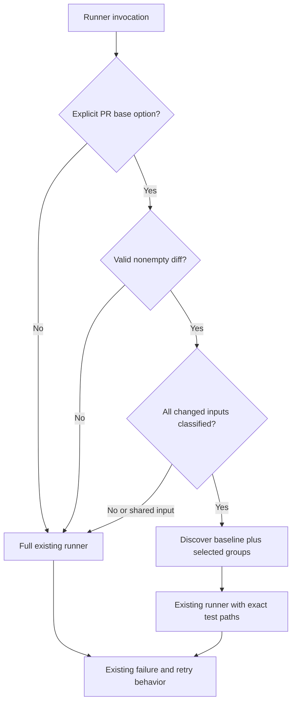

# Select Expensive Linux Test Groups - Plan

## Goal Capsule

- Objective: Contributors receive faster PR feedback for changes confined to one plugin area.
- Means: Select expensive runtime groups while retaining an unconditional baseline (KTD1).
- Authority: Expand PR #1941 on its existing branch; implementation and PR update are authorized, merging is not.
- Execution profile: Mechanical CI and runner changes. No skill prose changes or behavioral model evaluations.
- Stop condition: Evidence that a required dependency cannot be safely classified must widen selection, not silently omit coverage.

---

## Product Contract

### Summary

Extend the existing platform-job selector to avoid unrelated expensive Linux runtime tests. Keep metadata, schema, typecheck, and the inexpensive remainder on every PR. Show the selected groups and the reason for a full fallback.

### Problem Frame

The initial selector would still run the full Linux suite for every PR and all specialized jobs for 45 of 50 sampled historical commits. The principal cost is concentrated in subprocess-heavy skill tests, so platform selection alone leaves the bottleneck largely unchanged. Supplied local evidence measured roughly 127 seconds wall time; summed case timings identify expensive files but do not predict hosted wall-time gains.

### Requirements

**Selection and correctness**

- R1. PRs run every baseline test plus every expensive group whose inputs changed.
- R2. Unknown changed inputs, shared infrastructure changes, unavailable comparison evidence, and empty comparisons run the full suite.
- R3. New test files run automatically; edits to an existing grouped test select its group.
- R4. Main pushes, manual CI runs, and ordinary local test invocations run the full suite.

**Execution and evidence**

- R5. Selected runs preserve the existing runner's parallel execution, lost-child recovery, timeout-only serial rerun, and failure propagation.
- R6. Release/schema/typecheck gates and the required `test` job remain unconditional.
- R7. CI reports selection counts and groups; the PR reports historical selection coverage and observed timings without equating summed case durations with wall time.

### Key Decisions

- **Broaden selection to Linux runtime groups** (session-settled: user-approved — chosen over stopping at platform-only selection: the main bottleneck remained unconditional). Governs R1, R7.
- **Retain conservative fallback and full main/manual validation** (session-settled: user-approved — chosen over blanket skipping: shell, Python, resource, and cross-file dependencies need explicit coverage). Governs R2, R4.

### Scope Boundaries

No probabilistic coverage graph, extra matrix of Linux jobs, worker-count cap, automatic nightly tuning, or runtime-test refactor is needed to obtain the first useful reduction. Reconsider finer partitions only if measured selected-run time remains dominated by one group. Native-platform predicate refinement is optional only where the same dependency evidence supports it; do not widen the implementation merely to lower a count.

---

## Planning Contract

### Key Technical Decisions

- KTD1. Keep an explicit small catalog of expensive test files grouped by ownership, and derive baseline as all discovered runnable tests minus that catalog. This implements R1/R3 without requiring each future test to be registered. Discovery must honor the existing `bunfig.toml` fixture exclusion and match Bun's runnable filename conventions.
- KTD2. Select groups from owned directories, including Markdown/resources, plus known external inputs. Shared test helpers/fixtures, CI/config/dependency files, and unknown paths select full. Test files outside the catalog stay in baseline; owner-directory coverage avoids pretending shell/Python dependency discovery is a TypeScript import graph.
- KTD3. Add an explicit `--changed-since=<SHA>` runner option, used only by PR CI. Resolve evidence inside the Linux job using the existing NUL-delimited, no-renames git comparison. Strip the option before all Bun passes. Reject combinations with user test-path/name/change filters that would narrow the unconditional baseline. Default invocation remains untouched.
- KTD4. Feed selected exact paths, prefixed `./`, into the same runner process. Preserve retry internals; retries receive cleaned Bun arguments. The Linux `test` job remains independent of the optional-job `scope` job.
- KTD5. Selection metadata belongs in the job summary. Bun's native per-file timing output can be uploaded from CI using the already verified runtime support; do not build a custom timing parser or tuning service.

### Initial Group Boundaries

| Group | Explicit expensive tests | Inputs selecting the group |
|---|---|---|
| Cross-model | Four `tests/skills/ce-{work,code-review,doc-review,pov}-cross-model-routes.test.ts`; `ce-work-cross-model-integration.test.ts`; `peer-job-runner.test.ts` | Any file in the four owning skill directories; mirrored peer runtime changes outside these owners use full fallback |
| Workspace | Existing `tests/skills/ce-work-unit-workspace-*.test.ts` files, explicitly listed | `skills/ce-work/**` |
| Babysit | `tests/ce-babysit-pr-snapshot.test.ts` | `skills/ce-babysit-pr/**` |
| Setup | `tests/skills/ce-setup-check-health.test.ts` | `skills/ce-setup/**`, `skills/ce-polish/**`, `docs/guides/**`, `README.md`, `.compound-engineering/config.example.yaml` |
| Prototype | `tests/skills/ce-prototype-server.test.ts` | `skills/ce-prototype/**` |

The table defines the starting catalog, not a new test hierarchy. Shared helpers/fixtures run full under R2 rather than maintaining their own dependency graph. Add a specific discovered transitive input to its owner mapping before allowing it to skip that group. Unrecognized executable files under other skills run full; unrelated skill Markdown, converter source, and ordinary documentation may select baseline after checking the explicit owner/input mappings first.

### Source Evidence

`tests/skills/ce-doc-review-cross-model-routes.test.ts` reads both its own skill/reference Markdown and the code-review twin. `ce-code-review-cross-model-routes.test.ts` executes both review wrappers. `ce-pov-cross-model-routes.test.ts` reads its persona. The workspace harness uses both `unit-workspace.py` and `cross-model-work.sh`; cross-model-work integration also invokes its peer runner. Setup-health reads the guide/config paths above, the root README, and ce-polish skill/reference prose. These are reasons for coarse ownership rather than script-extension matching.

`docs/solutions/developer-experience/always-on-agents-md.md` records that local gains do not predict hosted gains and that fixed worker counts caused contention. Existing `scripts/run-tests.ts` owns subprocess/retry behavior; `scripts/ci-scope.ts` already treats failed diff evidence as full.

### High-Level Technical Design

### Assumptions

A five-group catalog is sufficient for the first expansion. The existing full main run supplies ongoing coverage of skipped groups; this does not make a missed PR dependency acceptable. Timing artifacts are evidence for later tuning, not a prerequisite for successful test results.

---

## Implementation Units

### U1. Define Linux groups and safe selection

**Goal:** Resolve changed paths to a complete runnable test set under R1–R3 and KTD1–KTD2.

**Dependencies:** None.

**Files:** `scripts/ci-scope.ts`, new `scripts/test-scope.ts` if separation keeps optional-job classification small, `tests/ci-scope.test.ts`, new `tests/test-scope.test.ts` if warranted by that separation.

**Approach:** Reuse the comparison boundary; keep platform classification and Linux selection independently testable. Enumerate expensive members explicitly and discover baseline dynamically. Filter absent/deleted catalog files from execution, but use deleted input paths for selection.

**Patterns:** Existing selector's malformed-path fallback and throwaway git fixture tests.

**Test scenarios:**

1. Unrelated converter, docs, or skill Markdown selects baseline and no unrelated expensive group.
2. A work-owned change selects cross-model and workspace, while a code-review change selects cross-model alone.
3. Setup guide/config inputs, including `docs/guides/ce-plan.md`, root README, and ce-polish prose select setup even though they are outside its skill directory.
4. An edited grouped test selects its complete group; an unregistered test appears in baseline.
5. Shared helper, shared fixture, package/runner/CI config, malformed path, unknown executable, and unavailable or empty diff select full.
6. A move between owners selects both owners through old and new paths; a deleted test is not passed as a missing executable path.
7. Eval fixture tests remain excluded, and the catalog is disjoint with baseline while their union equals runnable discovery.

**Verification:** Selector scenarios demonstrate no omitted runnable baseline tests and safe fallback.

### U2. Integrate selection into the existing test runner

**Goal:** Implement R4–R6 using KTD3–KTD4.

**Dependencies:** U1.

**Files:** `scripts/run-tests.ts`, `tests/run-tests-script.test.ts`, `.github/workflows/ci.yml`, `tests/ci-scope.test.ts`.

**Approach:** Handle the selector option once before execution. CI supplies the PR base through an environment value used as a quoted argument, with sufficient checkout history; missing evidence reaches full fallback. Ordinary invocations retain their current path. Keep the Linux job independent from scope-job success. Update disposable fixtures that copy the runner so any new imported selector module accompanies it; preserve timing arguments across retries.

**Test scenarios:**

1. A disposable fixture run executes baseline and its selected group but not another group's sentinel.
2. Default invocation selects the full fixture suite; malformed/missing base evidence also selects full.
3. Selector flags never reach the initial Bun process or timeout retry; incompatible narrowing flags fail clearly.
4. Existing assertion-failure, timeout-only rerun, and lost-child recovery tests continue to pass with cleaned arguments.
5. Workflow checks preserve unconditional metadata/schema/typecheck and full main/manual runs.

**Verification:** Runner integration proves actual executed tests, not just selected arrays, and existing lifecycle tests remain green.

### U3. Document and measure the expanded boundary

**Goal:** Make R7 reviewable and keep contributor instructions accurate.

**Dependencies:** U1, U2.

**Files:** `docs/guides/ci.md`, `AGENTS.md`, `.github/workflows/ci.yml` if native timing artifact is added, `tests/ci-scope.test.ts` for changed workflow contracts.

**Approach:** Replace the obsolete unconditional-full-Linux claim. Document default full local runs, explicit selected runs, group ownership and fallback. Replay the same recent 50-commit sample against the new selector and report baseline-only, partial, and full counts, cross-model group omissions, and omitted summed-case work. Label work estimates separately from wall time. Compare a representative baseline-only invocation and a group-owned invocation with full run on the same machine; report the actual hosted full-fallback CI timings. Hosted selected-run gains remain unverified until a later eligible run; no extra PR or merge is required for this work.

**Test scenarios:**

1. Selection summary distinguishes selected versus full with a reason and counts.
2. If timing artifacts are added, failed tests still fail CI and missing artifact output does not mask the original failure.

**Verification:** Historical replay shows more than 5/50 commits avoiding a Linux group as a minimum floor; this is a new metric, not directly comparable with the earlier specialized-job count. Judge the actual benefit using the omitted expensive groups and measured representative runs. If that threshold is not met, investigate the overbroad fallback before declaring the optimization complete.

---

## Verification Contract

Run targeted selector/runner tests while implementing, followed by `bun run test`, `bun run typecheck`, and `bun run release:validate`. Keep `plugin:validate` in CI. No skill prose changes are planned, so fresh-agent behavior evaluation is not required. Validate the PR's actual workflow, including a full fallback for this infrastructure-changing PR; representative selected runs must be exercised separately because this PR correctly triggers full coverage.

The measurable selection exit criterion is more than 5 of the same 50 historical changes avoiding at least one expensive Linux group. Record actual wall time for full and representative selections, without inventing a universal speedup target from one local sample.

---

## Definition of Done

The catalog and fallback are covered by executable tests; ordinary local/full CI paths retain their previous coverage and recovery semantics. Historical replay meets the selection floor and reports omitted heavyweight work; measured local examples demonstrate reduced work. Hosted selected-run gains are explicitly unverified where no eligible hosted run exists. Documentation matches shipped behavior, all required checks pass, and abandoned experimental code is removed. The existing PR is updated with the final scope and exact verification; no merge occurs.
