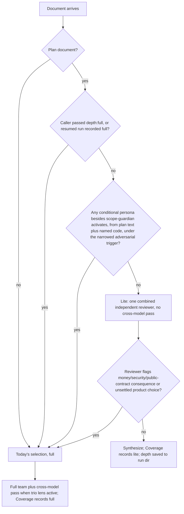

# Rightsize lfg Review Cost - Plan

## Goal Capsule

- **Objective:** A hands-off lfg run on a small, routine change costs roughly what the change needs, while a change that makes an unsettled product decision or crosses a money or security boundary (R11) gets at least today's plan and code scrutiny, whether the plan states the boundary or only its named code crosses it.
- **Means:** ce-doc-review chooses its own depth by consequence (KTD1-KTD4); ce-simplify-code gets a single-pass mode that lfg selects below a measured size cutoff (KTD5-KTD7); per-stage cost is measured from our own host session logs before and after (KTD8).
- **Authority:** Product Contract Rs win on behavior; KTDs win on mechanism; `docs/solutions/skill-design/portable-agent-skill-authoring.md` and `ce-skill-work` govern every edit under `skills/**`.
- **Stop conditions:** Stop PR4 and report if the U1 baseline shows doc review and simplify together are under 20% of a small-task lfg run's median dollars (the savings would not justify the change; PR3 proceeds regardless, per Key Decision 3). Stop and report if any U2 eval shows a boundary or unsettled-product plan landing on lite.
- **Execution profile:** Four PRs (see Implementation Units). U4's diagnosis ships no skill fix; fixes it motivates are follow-up work.
- **Who finishes:** `ce-work` per PR, then `ce-commit-push-pr`. Behavioral evals are maintainer-run on local host CLIs.

---

## Product Contract

### Summary

Hands-off lfg pays for a full plan-review team and a full simplification team on every change, regardless of stakes. This plan makes ce-doc-review pick a lite path for routine plans and a narrower adversarial trigger, gives ce-simplify-code a single-pass mode that lfg uses for small diffs, and measures per-stage cost on real lfg runs so the simplify cutoff and the savings are set from data. A diagnostic eval locates where the #1999 Zoom miss (passcode emailed before payment) happened, without fixing it here.

### Problem Frame

Surge's benchmark in issue #1999 measured CE at 8x cost for a result inside noise, and a small Zoom-link task drew 17 agents: 5 plan reviewers, 5 simplification reviewers, 7 code reviewers. The 8x is our pipeline working as designed. ce-doc-review's adversarial persona fires on every plan without a validated upstream Product Contract (`skills/ce-doc-review/references/persona-selection.md:25`), which is every hands-off lfg plan, and adversarial activation opens the cross-model pass (`skills/ce-doc-review/references/cross-model-review.md:11,98`). lfg runs simplify on anything over roughly 10 lines (`skills/lfg/SKILL.md:39`), while ce-work and ce-debug use 30, and ce-work's phase-boundary simplify still runs under lfg, so one diff can be simplified twice. ce-code-review already sizes itself by consequence (`skills/ce-code-review/references/modes-and-output.md:65-79`); the other two stages do not. We cannot say which stage dominates cost because only ce-code-review logs stage cost.

### Key Decisions

- **Keep full code review on money, auth, and public-contract changes.** ce-code-review's depth gate is not changed. (session-settled: user-approved — chosen over loosening code review alongside the others: the Zoom miss shows boundary changes need more scrutiny, not less.) Governs R11.
- **Size simplification by diff size; size plan review by consequence.** (session-settled: user-approved — chosen over one size rule for both: a wrong simplification is loud and local, a wrong plan can ship silently, per `docs/solutions/skill-design/review-cost-is-in-entering-the-spine-not-the-findings.md`.) Governs R1, R7.
- **Only the simplify cutoff waits for measurement.** The doc-review changes proceed now and are validated by evals. (session-settled: user-approved — chosen over holding all changes for the baseline: doc-review depth is a consequence rule, not a tunable number.) Governs R8, R12.
- **The boundary eval is diagnostic only.** (session-settled: user-approved — chosen over fixing the Zoom miss in this plan: a fix written before the miss is located would be a guess.) Governs R14.

### Requirements

**Plan review depth (ce-doc-review)**

- R1. ce-doc-review decides its own depth, lite or full, from the consequence of a wrong plan; a caller may force full and never requests lite.
- R2. A plan document runs lite only when, after R5's narrowed trigger, no conditional persona other than scope-guardian would activate, judged from the plan text and from what the files and code paths it names do; requirements docs and other document types keep today's selection.
- R3. Lite still provides coherence, feasibility, and scope-sizing judgment from a reviewer other than the plan's author, and never runs the cross-model pass.
- R4. A lite run that surfaces a money, security-boundary, or public-contract consequence, or a product choice no requester or upstream contract made, escalates to full in the same invocation.
- R5. Adversarial's provenance trigger fires when the plan makes a product choice (what users get, what is deferred, who can do what) that no requester, upstream contract, or settled decision made, not when a plan merely lacks a brainstorm.
- R6. The chosen depth is recorded in the result's Coverage and in the run directory, and a later round or resume keeps or raises it, never lowers it.

**Simplification sizing (ce-simplify-code and lfg)**

- R7. ce-simplify-code accepts a caller-supplied size cutoff and, when the substantive lines it measures fall below it, runs a single pass instead of the 3-5 reviewer team.
- R8. lfg always passes the cutoff, set from U1's measurements.
- R9. Under lfg, no stretch of the diff is simplified twice: lfg's step-3 simplify covers only what ce-work's phase-boundary simplify has not.
- R10. ce-simplify-code's summary states which mode ran.

**Scrutiny that must not drop**

- R11. Money, auth, and public-contract changes keep ce-code-review's full path, and plans that cross a money, security, or public-contract boundary keep full plan review with their challenge lenses. A security boundary is the set security-lens already activates on: auth and authorization, sensitive data (PII, payment data, tokens, credentials, secrets, encryption), endpoints exposed to external clients, and third-party trust boundaries. Ordinary data handling, storage churn, and touching a non-sensitive endpoint are not boundaries, so routine plans stay lite.

**Measurement and diagnosis**

- R12. Per-stage dollars, agent counts, and parent-context growth are measured for lfg runs on Claude and Codex from host session logs on maintainer machines, before and after the changes, against vanilla at xhigh effort.
- R13. No measurement ships in the plugin or runs on users' machines.
- R14. A diagnostic eval locates the release-before-payment miss to one stage, and tests whether the shared intent summary anchors code reviewers on the plan's framing.

### Acceptance Examples

- AE1. **Covers R2, R5.** Given a hands-off lfg plan to add a `--json` flag to an existing CLI command, with no payment, auth, or new product behavior, when ce-doc-review runs non-interactively, then it runs lite and Coverage says lite.
- AE2. **Covers R2, R11.** Given a hands-off plan that emails a meeting passcode once a booking is created, in an app that takes payment, when ce-doc-review runs, then it runs full with security-lens and adversarial active.
- AE3. **Covers R4.** Given a plan that reads routine but whose lite reviewer notes that a new endpoint returns another user's records, when the lite pass returns, then the same invocation reruns at full before ce-plan sees findings.
- AE4. **Covers R6.** Given a lite first round and ce-plan's re-invocation after a correction, when ce-doc-review resumes, then it reruns the lite pass, not "the reviewers whose lens changed", and Coverage still says lite.
- AE5. **Covers R2.** Given a ce-sweep plan bundling a typo fix and a billing-retry item, when ce-doc-review selects depth, then it runs full because the billing item crosses a money boundary.
- AE6. **Covers R7, R9.** Given ce-work simplified through commit `abc123` and the remaining diff is 12 substantive lines under a cutoff of 30, when lfg reaches step 3, then ce-simplify-code runs single-pass on the diff after `abc123`.
- AE7. **Covers R2, R11.** Given a plan to send a booking confirmation that never mentions payment, but names the checkout handler that marks a booking paid, when ce-doc-review selects depth, then it runs full.
- AE8. **Covers R2, R11.** Given a plan to extend a "remember me" option that never mentions auth, but names the session-token issuing code, when ce-doc-review selects depth, then it runs full with security-lens active.
- AE9. **Covers R2, R11.** Given a plan to show a user's display name in a page header, naming an ordinary profile read, when ce-doc-review selects depth, then it runs lite, because reading non-sensitive user data is not a security boundary.

### Scope Boundaries

- ce-code-review's depth gate, the README's claims, and lfg's brainstorm routing are out of scope.
- No new reviewer persona and no Zoom-specific rule.

#### Deferred to Follow-Up Work

- Whatever fix U4's diagnosis points to (persona selection, discovery, synthesis, or intent-summary anchoring).
- Revisiting `README.md:117` and `:139` once U6's numbers exist.

---

## Planning Contract

### Key Technical Decisions

- KTD1. **Lite is decided inside ce-doc-review, keyed on which personas would activate.** The selector runs the existing persona selection with R5's trigger; if only coherence, feasibility, and scope-guardian survive, depth is lite. This avoids defining "loud" for plans and leaves no unclassified middle: a silent, non-boundary, settled plan is lite; anything a challenge lens would claim is full. Mirrors code review's ownership rule (`skills/ce-code-review/references/modes-and-output.md:67,77`). Activation reads the plan text and also the files and code paths the plan names, a bounded read of those paths, not a repo scan, so a boundary the plan does not state still activates its lens (AE7, AE8). The read uses security-lens's existing bound (`persona-selection.md:16`) unchanged, so touching user data or an endpoint is not by itself a trigger (AE9). A new `depth:full` token lets callers force full. Implements R1, R2.
- KTD2. **Lite is one combined independent reviewer, not an in-context pass.** It is dispatched once at the mid tier with the coherence, feasibility, and scope-guardian persona text, and returns the same finding schema. Chosen over the in-context pass named in the original request: ce-doc-review runs in the session that just wrote and confidence-checked the plan, so an in-context pass is the author grading itself, and in-context steps grow parent context, which cost more than all subagents combined in measured runs (`docs/solutions/skill-design/portable-agent-skill-authoring.md`). If dispatch is unavailable, run it inline and record in Coverage that the lite review was not independent; an inline pass cannot satisfy R3, so the result must not claim it did. Implements R3.
- KTD3. **Escalation is keyed on the deciding property, not severity.** The lite reviewer flags any money, security-boundary (as R11 defines it), or public-contract consequence or unsettled product choice; on that flag, ce-doc-review reselects at full in the same run. P0/P1 alone does not escalate, because a routine plan can have a P1 coherence error. Per `docs/solutions/skill-design/key-exclusions-on-the-deciding-property-not-an-echoed-word.md`, the flag is defined by "money moved, access granted, or sensitive data exposed wrongly", not keywords. Implements R4.
- KTD4. **Restate adversarial's provenance trigger by property and delete the bootstrap sentence.** Replace `persona-selection.md:25` with R5's property and remove the clause at :29 that says `ce-plan-bootstrap` does not suppress premise techniques. A choice a requester or feedback item asked for counts as made. The high-stakes-domain bullet stays, so payments and auth still fire adversarial. Delete pull-toward-full prose rather than adding "be lighter" prose (`docs/solutions/skill-design/right-size-plans-by-subtraction-and-a-usage-first-sizing-test.md`). Implements R5.
- KTD5. **The cutoff is a caller token measured in ce-simplify-code's preflight.** Token `size-cutoff:<N>` sits beside `mode:pipeline`; preflight already separates substantive code from the rest (`skills/ce-simplify-code/SKILL.md:28`), so the count lives in one place, and the caller still owns the threshold. Chosen over lfg counting lines itself, which would add a second, inconsistent counter. Implements R7, R8.
- KTD6. **Single-pass is one combined reviewer subagent, with the existing inline fallback.** It carries the reuse, quality, and efficiency lenses in one brief; `references/reviewer-dispatch.md:7`'s inline fallback still applies. Same reasoning as KTD2 on parent context. Implements R7.
- KTD7. **ce-work reports `simplified_through: <sha>`; lfg scopes step 3 to the diff after it.** Chosen over disabling ce-work's phase-boundary simplify in return-to-caller mode, which would strip simplify from ce-babysit-pr's rework path. Other callers ignore the field. Implements R9.
- KTD8. **Measure from host session logs, not by spreading `run-log.py`.** A collector in a new eval pack reads Claude `-p` stream logs (dedupe by `tool_use` id) and Codex session logs (dedupe by `call_id`), attributes tokens to lfg's top-level step that is active, and prices them in dollars. A skill nested inside a step (ce-work's phase-boundary simplify, a subagent) is charged to the step that invoked it and also reported as a sub-row, so a nested simplify does not inflate lfg's own simplify step. Chosen over copying `skills/ce-code-review/scripts/run-log.py` into each skill, which hardcodes code-review stages (:25,:30,:161), rarely gets token counts, and would need byte-parity tests per copy. ce-optimize can drive repeated runs with the collector as its JSON measurement command. Satisfies R12, R13 (logs stay on the maintainer's machine).
- KTD9. **Report medians and frame savings as non-inferiority.** N=3 per task per host; score defect detection separately from whether a reviewer asserted it (`docs/solutions/skill-design/benchmark-review-peer-model-and-reasoning-tier.md`). Implements R12, R14.

### High-Level Technical Design

Directional only; the reference prose owns the exact wording.

ce-doc-review depth selection:

Simplify mode under lfg:

| ce-work return | Substantive lines after `simplified_through` vs `size-cutoff:<N>` | lfg step 3 |
|---|---|---|
| no `simplified_through` | whole branch diff measured | single-pass if below N, else full team |
| `simplified_through: <sha>` | diff after `<sha>` measured | single-pass if below N, else full team |
| any | fewer than roughly 10 substantive lines remain | skip, as today |

### Assumptions

- Hands-off lfg plans for routine changes rarely carry an explicit alternatives section; if U1 or U2 runs show adversarial firing on KTD "chosen over" lines as an alternatives section, that bullet needs the same property restatement.
- The #1999 transcript may not arrive; U4 then builds its fixture from the issue's description.

### Risks

| Risk | Mitigation |
|---|---|
| Codex reads the restated trigger literally and keys on words like "deferred" | Write the trigger as a property; include a routine plan that uses those words in U2's evals |
| Strong models mask the gate change by doing well either way | Grade persona selection with the `TEAM:` trailer and depth with a `DEPTH:` trailer, not only final findings |
| Lite misses a defect full would catch on a routine plan | U2 non-inferiority check on `doc-review-routine-fix` and a lite-must-stay-lite control |
| SKILL.md byte budgets (ce-doc-review 7,792, ce-simplify-code 7,852 of 8,000) | New mechanics go to `references/` with a one-line pointer |

---

## Implementation Units

### PR1: Stage-cost measurement and baseline

Waits on: nothing.

### U1. lfg stage-cost collector and baseline

- **Goal:** Measure per-stage dollars for lfg on current main so later units have a baseline and U3 has its cutoff.
- **Requirements:** R12, R13; KTD8, KTD9.
- **Files:** `tests/skill-eval-cell/packs/lfg-stage-cost.md`, `tests/skill-eval-cell/packs/lfg-stage-cost/collect.ts` (extend the pattern in `tests/skill-eval-cell/packs/ce-ideate-run-scaling/collect.ts`), fixture task repos under `tests/skill-eval-cell/fixtures/`, a ce-optimize spec in the pack modeled on `skills/ce-optimize/references/example-expensive-benchmark-spec.yaml`.
- **Approach:** Three tasks: a small non-boundary change (adds a CLI flag), the Zoom-shaped task (passcode email gated on payment), and a medium feature. The Zoom task measures detection, not savings. Attribute tokens to lfg's top-level step per KTD8, count agents per stage, and record parent-context growth. Run lfg and vanilla-at-xhigh on Claude and Codex, N=3, and report medians in dollars plus whether each run caught the payment ordering.
- **Test scenarios:**
  - Collector on a recorded Claude log with duplicated `tool_use` events counts each once.
  - Collector on a Codex log attributes a subagent's tokens to the stage that spawned it.
  - A log with no Skill boundary reports all tokens under one `unattributed` stage rather than failing.
  - A ce-work step that runs a phase-boundary simplify reports those tokens as a sub-row of ce-work, not under lfg's step-3 simplify.
- **Verification:** `bun run test tests/skill-eval-cell` passes; the pack's baseline table is filled for both hosts.

### PR2: Boundary diagnostic eval

Waits on: nothing (parallel with PR1).

### U4. Release-before-payment diagnostic

- **Goal:** Locate the Zoom-style miss to discovery, persona selection, finding, or synthesis, and test intent-summary anchoring.
- **Requirements:** R14; KTD9.
- **Files:** a new fixture under `tests/skill-eval-cell/fixtures/` (released before paid; visible before authorized), scenarios in `tests/skill-eval-cell/catalog.ts` near the doc-review persona scenarios (:5102-5175) and code-review depth scenarios (:4235-4922), `tests/skill-eval-cell/packs/boundary-diagnostic.md`.
- **Approach:** Freeze the plan and diff in the state the pipeline met them, from the #1999 transcript if Surge shares it. Without the transcript, test the ce-plan stage by running ce-plan fresh (N≥3 per host) on the request text the issue gives, and run the later stages on both a plan that names the ordering and one that does not. Check, per stage: did ce-plan name the ordering; which personas selection chose (`TEAM:`); whether the ordering appeared in any reviewer's raw return in the run directory and whether it survived synthesis, so a dropped finding is not mistaken for one never raised; what ce-code-review found with and without the intent summary from `skills/ce-code-review/references/intent-and-plan.md:42-49`. Code review also discovers the plan separately (a `plan:` argument, a PR-body link, or a branch-keyword match), so neither arm passes or exposes a plan file; the "with" arm carries the plan's framing in commit messages and PR body, and the "without" arm uses neutral commits and no PR body. Include a plan that never names the boundary while its diff crosses it. Include a routine control. N≥3 on Claude and Codex.
- **Test scenarios:**
  - Boundary plan: record whether security-lens and adversarial activate and whether any finding names the ordering.
  - Same diff, intent summary present vs absent: compare detection rates.
  - Routine control: no boundary finding is asserted.
- **Verification:** The pack reports the stage where detection is lost, with per-host rates; `bun run test tests/skill-eval-cell/catalog.test.ts` passes. A result built from the issue text is labeled as a reconstruction, and whether it explains Surge's original run is marked unresolved. "Not reproduced at any stage", with per-stage rates, is a valid result and leaves the deferred fix with nothing to act on. When the hosts lose detection at different stages, each is reported, and the follow-up targets a stage common to both if one exists.

### PR3: ce-doc-review depth

Waits on: nothing to merge first; its eval reruns use U1's harness for the after measurement in U6, not to land.

### U2. ce-doc-review lite path and narrowed adversarial trigger

- **Goal:** Routine plans get one independent combined review; boundary and unsettled-product plans keep full review.
- **Requirements:** R1-R6, R11; KTD1-KTD4.
- **Files:** `skills/ce-doc-review/SKILL.md` (one pointer line), new `skills/ce-doc-review/references/depth.md`, `skills/ce-doc-review/references/persona-selection.md`, `skills/ce-doc-review/references/document-intake.md` (resume keeps depth), `skills/ce-doc-review/references/synthesis-and-presentation.md` (Coverage depth line), `skills/ce-plan/references/plan-handoff.md` (free-form "deep/full review" passes `depth:full`), tests `tests/pipeline-review-contract.test.ts` (:968-997, :1069-1088), `tests/skill-eval-cell/catalog.ts` and `tests/skill-eval-cell/catalog.test.ts` (:221-224).
- **Approach:** Follow `ce-skill-work`. The depth reference owns the gate, escalation, resume, and later-round rules; persona-selection.md carries only the restated trigger. Lite saves its reviewer's evidence and depth to `$SCRATCH_ROOT/ce-doc-review/<run-id>` so `document-intake.md:14`'s resume rule accepts it. Callers stay unchanged except ce-plan's free-form route.
- **Execution note:** Run the U2 evals pre-change first so each scenario has a before result.
- **Test scenarios:**
  - AE1 routine bootstrap plan -> `DEPTH: lite`, `TEAM:` lacks adversarial.
  - AE2 passcode/payment plan -> `DEPTH: full` with security-lens and adversarial.
  - Brainstorm-origin routine plan -> lite.
  - Requirements doc -> today's team, unchanged.
  - AE5 mixed sweep plan -> full.
  - AE7 unstated payment boundary and AE8 unstated session-token boundary -> full.
  - AE9 ordinary profile read -> lite (over-escalation control).
  - AE3 escalation and AE4 resume.
  - A routine plan using the words "deferred" and "who can" -> still lite (literal-keyword control).
  - `doc-review-routine-fix` lite vs full findings: non-inferior on its seeded defect.
  - Rerun `tests/skill-eval-cell/packs/ce-plan-sizing.md` to confirm scope-sizing still holds on lite.
- **Verification:** Evals on Claude and Codex, N≥3, pass both sides; `bun run test:skill-guards` and the pinned tests above pass.

### PR4: Simplify sizing

Waits on: PR1 merged and its baseline published (sets N).

### U5. ce-work reports `simplified_through`

- **Goal:** lfg knows which commits ce-work already simplified.
- **Requirements:** R9; KTD7.
- **Files:** `skills/ce-work/references/return-to-caller.md`, `skills/ce-work/references/implementation-loop.md` (:91 records the SHA), `tests/pipeline-review-contract.test.ts`.
- **Approach:** Add the field to the return block only when a phase-boundary simplify ran; other callers are unaffected.
- **Test scenarios:**
  - A run with a phase-boundary simplify returns the SHA of its last simplified commit.
  - A run with no simplify omits the field.
- **Verification:** `bun run test tests/pipeline-review-contract.test.ts` passes.

### U3. ce-simplify-code single-pass mode and lfg cutoff

- **Goal:** Small diffs under lfg get one simplification pass.
- **Requirements:** R7, R8, R10; KTD5, KTD6.
- **Dependencies:** U5, U1's baseline.
- **Files:** `skills/ce-simplify-code/SKILL.md` (one pointer line), new `skills/ce-simplify-code/references/single-pass.md`, `skills/lfg/SKILL.md` (:39 passes `size-cutoff:<N>` and the base from `simplified_through`), `skills/lfg/references/review-followup.md`, `skills/lfg/references/debug-return.md`, tests `tests/pipeline-review-contract.test.ts` (:1350-1385, :457-468), `tests/skills/lfg-intake-contract.test.ts` (:241), and `skills/ce-help/references/workflow.md` with `tests/skills/ce-help-contract.test.ts` if the stated interplay changes.
- **Approach:** Follow `ce-skill-work`. N comes from U1; start from the hypothesis of 30 to match ce-work and ce-debug and change it only if the baseline shows a better break point. lfg keeps its skip below roughly 10 substantive lines; single-pass covers the range from there up to N, so no change gets a pass it skips today.
- **Test scenarios:**
  - 5 substantive lines under lfg -> skipped, no simplify pass runs.
  - 12 substantive lines under `size-cutoff:30` -> single-pass, summary names it.
  - 45 lines -> full team.
  - No cutoff token (standalone use) -> today's behavior.
  - AE6 scoped to the diff after `simplified_through`.
  - Plan file and test fixtures in the diff do not count toward the cutoff.
- **Verification:** Evals on Claude and Codex, N≥3, using `tests/skill-eval-cell/packs/ce-simplify-code-pruning.md`'s format; `bun run test:skill-guards` and pinned tests pass.

### U6. After measurement

- **Goal:** Report what U2 and U3 saved and whether detection held.
- **Requirements:** R12; KTD9.
- **Dependencies:** U1, U2, U3.
- **Files:** `tests/skill-eval-cell/packs/lfg-stage-cost.md` (after table).
- **Approach:** Rerun U1's tasks on the same hosts and N; compare medians per stage and the Zoom detection rate.
- **Test expectation:** none -- measurement report, no code behavior.
- **Verification:** The after table exists for both hosts, and the small-task median drops with Zoom detection no worse than baseline.

---

## Verification Contract

| Check | Command or method | Applies to |
|---|---|---|
| Focused tests | `bun run test <changed test paths>` | every unit |
| Skill guards | `bun run test:skill-guards` | U2, U3, U5 |
| Pre-publish selection | `bun run test --changed-since=<base SHA>` on a clean commit | every PR |
| Types | `bun run typecheck` | U1, U4 (collector, catalog) and every PR |
| Release and plugin metadata | `bun run release:validate`, `bun run plugin:validate` | every PR |
| Behavioral evals | `bun run test:skill-eval-pack -- --skill <name> --arm ab` on Claude and Codex, N≥3; name any host that did not run and why | U2, U3, U4 |
| Byte budget | `tests/codex-skill-prompt-budget.test.ts` | U2, U3 |

---

## Definition of Done

- Global: R1-R14 each traced to a passing test or eval; no `skills/**` edit outside `ce-skill-work`; abandoned-attempt code and fixtures removed from the diff.
- U1: baseline medians per stage published for Claude and Codex, including vanilla xhigh.
- U2: AE1-AE5 and AE7-AE9 scenarios pass on both hosts, and the routine-plan scenarios fail before the change; ce-plan-sizing pack still passes.
- U3/U5: AE6 passes; lfg passes a cutoff on every simplify call; standalone simplify unchanged.
- U4: the stage where detection is lost is named per host, or the miss is reported as not reproduced, with no skill fix in the PR.
- U6: after table shows lower small-task cost and no worse Zoom detection, or the stop condition is reported.
