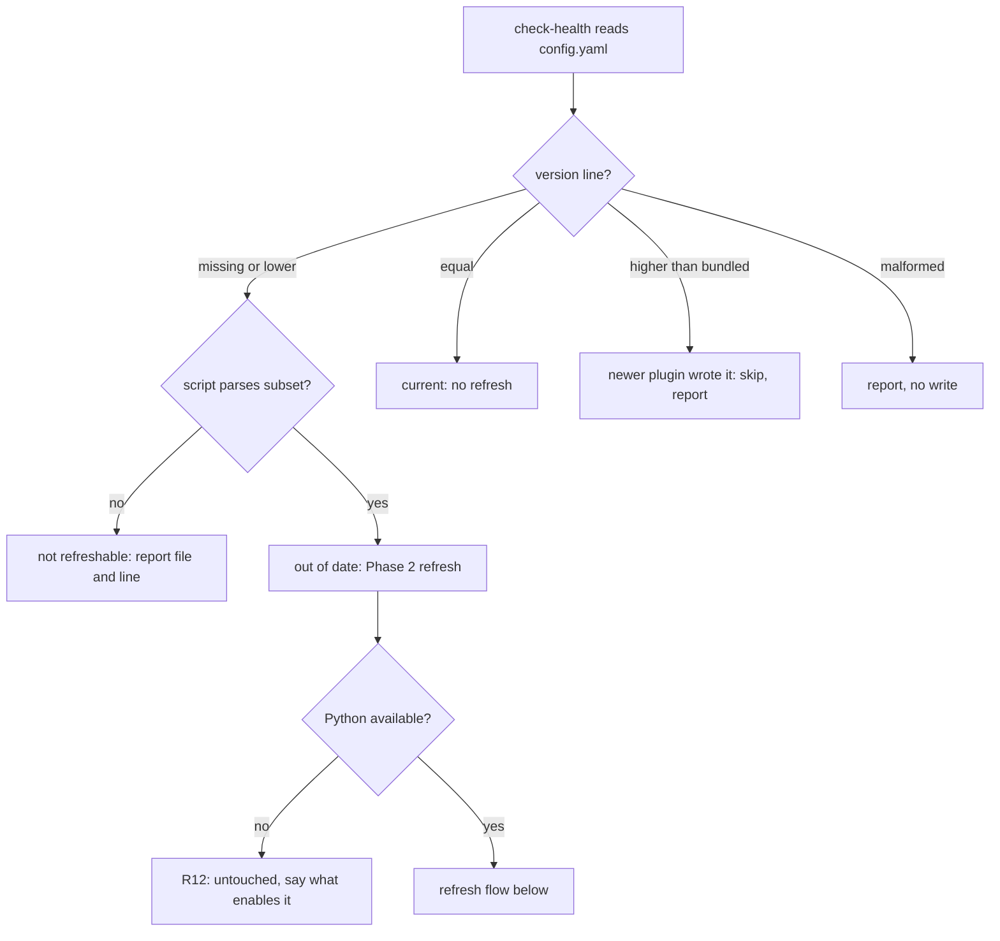
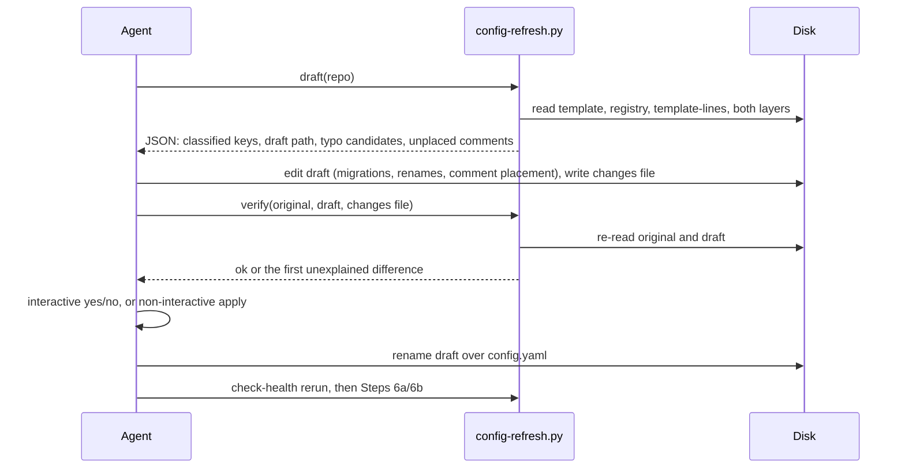

# ce-setup Config Refresh - Plan

## Goal Capsule

- **Objective:** A team that set up Compound Engineering months ago reruns `/ce-setup` and ends up with a `.compound-engineering/config.yaml` whose guidance matches the current plugin. Every setting that still does something survives with its value. Settings that no longer do anything are gone, and each change comes with a stated reason.
- **Means:** a versioned template, a retired-settings registry, and a deterministic refresh script that drafts and verifies the rebuild. The agent makes the judgment calls (KTD1, KTD3).
- **Authority:** Requirements (R-IDs) win on behavior. KTDs win on mechanism within them. Units implement and override neither.
- **Execution profile:** one PR. Units U1-U6 land together. No unit meets a Phase 3.3 split reason.
- **Stop conditions:** stop and report if the refresh cannot be verified without a YAML parser dependency, or if the ce-setup `SKILL.md` change cannot fit its remaining byte budget (about 200 bytes, CRLF-adjusted) as one sentence.
- **Who finishes:** `ce-work`, then `ce-commit-push-pr`. The behavioral eval (U6) runs before publishing.

---

## Product Contract

### Summary

`/ce-setup` will notice when `config.yaml` was written from an older template and rebuild it on the current one. The team's values stay in their slots. The agent migrates or removes retired settings itself, using one registry, and states a reason for each change. A script drafts the rebuild and checks from disk that nothing else changed before anything is written.

### Problem Frame

`ce-setup` creates `config.yaml` once, as a full copy of `skills/ce-setup/references/config-template.yaml` with every setting commented out (`skills/ce-setup/references/repo-fixes.md` Step 6). After that it never touches the file again. The template has changed 39 times since April. A team's file therefore keeps the guidance, defaults, and option lists from the day they first ran setup, and that stale text is what people read when they decide what to turn on.

Retired settings stay in the file without any warning. `scripts/check-health` knows only five retired keys, through two hardcoded lists that use different regexes. `work_delegate` and its five siblings, and `pr_branding`, go undetected, and nothing removes the fable keys the report does warn about. Checkouts set up before 2026-08-12 (#1360) instead have a full copy of the old template as `config.local.yaml`. Its comments still describe rules that have since changed, such as a local `docs_root` being honored.

The person running `/ce-setup` usually cannot judge what an upstream template change means for their file. Asking them to reconcile each setting gets guesses back.

### Requirements

**Detection**

- R1. The health report states `config.yaml`'s template status with its reason. The status is one of:
  - current
  - out of date (older version or no version line)
  - written by a newer plugin
  - malformed version line, reported and never rebuilt
  - not refreshable (outside the supported YAML subset, or duplicate top-level keys)
- R2. Retired settings in either config layer are detected from one registry. No retired-key list remains hardcoded in `check-health`, and detection still works without Python.

**Rebuild**

- R3. An out-of-date `config.yaml` is rebuilt on the current template:
  - each current setting's value block sits in that setting's slot
  - team comments attached to a setting move with it
  - guidance from old templates is dropped
  - unrecognized settings and free-floating team comments go in a marked section at the end
- R4. The agent makes every reconciliation decision itself, with no per-setting questions: migrations, removals, typo renames, and comment triage. Each change carries a one-line reason.
- R5. A migration never overrides a setting that is already active and would win, in that file or a layer that shadows it. In that case the retired key is removed and the reason names the setting that superseded it. An applied migration is described as the behavior change it causes, not as a rename.
- R6. Before writing, a check that reads both files from disk confirms every value survived unchanged apart from the recorded changes. Any failure leaves the file untouched and is reported.
- R7. An interactive run asks one yes/no for the whole rebuilt file, showing the change list. A non-interactive run applies the `config.yaml` rebuild and lists every change and its reason in the pull request. It only reports `config.local.yaml` changes.
- R8. ce-setup never rebuilds `config.yaml`, migrates `config.local.yaml`, or refreshes `config.example.yaml` when the file's template version is newer than the bundled template.
- R9. Rerunning ce-setup right after a refresh writes nothing and asks nothing.
- R10. `config.local.yaml` gets the same registry migrations and removals in an interactive run. Its layout is kept, except that a legacy full-template copy is cut down to its settings and team comments (KTD10).
- R11. The refresh carries `docs_root` and every invalid value through verbatim. The existing repairs (Steps 6a, 6b) run after it, on the refreshed file.
- R12. When the refresh cannot run (no working Python, script missing), the file is untouched and the summary says what would enable it.

**Maintenance**

- R13. A setting cannot leave the template without a registry entry. A registry key cannot also be in the template. The template cannot change without a version bump. `bun test` enforces all three.

### Key Decisions

- **The agent reconciles, the user approves once.** The person running setup cannot evaluate upstream config changes, so per-setting questions are replaced with agent decisions plus a reason for each. Governs R4, R7. (session-settled: user-directed — chosen over asking the user per migration, typo, or unknown key: "the user using ce-setup will have no way how to reconcile decisions given the config changes upstream")

### Success Criteria

- A fixture `config.local.yaml` that is a full copy of the pre-#1360 template, with `plan_use_fable: true`, a team comment above `cross_model_peer: codex`, and a `work_delegate: codex` line, comes out cut down to `cross_model_peer: codex` and its comment. `plan_use_fable` and `work_delegate` are gone, `plan_model` is not added, and there are two recorded reasons, each naming the current setting to use.
- A fixture `config.yaml` copied from the 2026-08-12 template, with an active `cross_model_peer: codex` and a team comment above it, comes out with the current template text, that setting and comment in its slot, and the current option list.
- A second run on that output is a no-op.

### Scope Boundaries

- How skills read config does not change. The cascade rule in `tests/fixtures/ce-config-layers-rule.md` and the `docs_root` fail-closed rule are untouched.
- No general YAML parser, and no new runtime dependency.
- Non-interactive runs do not write `config.local.yaml` (gitignored, so a reviewer could never see the change).
- Considered and not built:
  - **Bumping the version only on key changes, not comment changes.** That would leave comment-only guidance stale, which is the problem this plan fixes. Revisit if teams report the refresh prompt as noise.
  - **Converting `work_delegate: codex` into `work_engine_preferences`.** Its only reader was removed in #1013. Converting it would turn on engine routing the team has not had since June. It is removed with a pointer instead (KTD4).
  - **Agent-written rebuild when Python is missing.** It would skip the disk check that makes the rewrite safe. Revisit only if R12 reports show Python missing in many setups.

#### Deferred to Follow-Up Work

- None.

---

## Planning Contract

### Key Technical Decisions

- KTD1. **Agent judgment, no per-item questions.** Implements the product Key Decision. The agent applies registry entries, renames clear typos (script-ranked candidates), and triages comments. When unsure, it keeps a line in the marked section rather than dropping it. Governs R4. (session-settled: user-directed — chosen over per-setting questions: the user cannot reconcile upstream changes)
- KTD2. **Integer version line in the template header, enforced by a pinned hash.** The template's header gets `# ce-config-template-version: 1`. A file without the line counts as version 0. `tests/fixtures/ce-config-template-pin.json` stores the version and the sha256 of the template body with the version line removed. Editing the template without bumping and re-pinning fails `bun test`, and two PRs that both bump conflict on the header line. (session-settled: user-approved — chosen over detecting staleness by diffing commented layout: a team's own comments make a layout diff ambiguous, and the version also orders files so an older plugin cannot roll a newer one back)
- KTD3. **Split between the script and the agent.** (session-settled: user-approved — chosen over an agent-only rebuild: the user asked that deterministic work go to a script and judgment to the agent)
  - The script owns everything that has one right answer:
    - per-layer key classification (current, retired, unrecognized)
    - the version status
    - the rebuild draft with blocks in their slots
    - typo candidates ranked by edit distance
    - the final value check
  - The agent owns:
    - applying migrations whose meaning depends on the value
    - choosing typo renames
    - triaging comments the script cannot place
    - writing the reasons
- KTD4. **Registry entries have two kinds, `migrate` and `remove`.**
  - `migrate` maps old values to a target key with the same meaning, for a true one-to-one rename. No current retired key qualifies. The kind exists for future renames.
  - `remove` drops the key. Its reason names what replaced it, if anything.
  - There is no "ask" kind, by KTD1. Every key retired so far is `remove` with a pointer, because converting any of them would turn on behavior the team has not had for months:
    - `plan_use_fable` and `brainstorm_use_fable` point to `plan_model` and `brainstorm_model`. The reason notes that the new keys apply on every harness, while the old ones applied only on Claude Code and have done nothing since #1206.
    - `work_delegate*` points to `work_engine_mode` and `work_engine_preferences`.
    - `pr_branding` points to the per-run `branding:on` token.
    - `fable_nudge` has no replacement.
    - `work_engine_target` and `work_engine_model` point to `work_engine_preferences`.
  - Each entry is a column-0 key in `skills/ce-setup/references/retired-config-keys.yaml`, so `check-health`'s awk readers can list the names without Python. Seed the entries from the provenance table in the research (Sources).
- KTD5. **A known-template-lines file tells old template text from team comments.**
  - `skills/ce-setup/references/config-template-lines.txt` holds every normalized line that any shipped template contained. It is seeded once from git history, back through the pre-#1360 `config.local.yaml` template.
  - A test requires it to contain every line of the current template. Changing a template line therefore forces the new line to be added, while old lines stay. The file is append-only by construction.
  - The script sorts comment lines into three tiers:
    1. known template text, which is dropped
    2. lines attached to a setting, which move with it
    3. everything else, for the agent to judge
- KTD6. **Definition of "value preserved".**
  - A top-level key's block is its key line plus its continuation lines: indented lines and zero-indent `- ` list items, as `packs-resolve.py` `parse_packs_block` reads them. The block ends at its last continuation line, so full-line comments and blank lines after it are not part of it. Comment lines between continuation lines stay in it.
  - A key's value is its block with trailing whitespace and line endings normalized, minus any trailing inline comment that matches known template text (KTD5). The draft replaces such a comment with the current template's inline comment for that key, so active settings stop showing old option lists. A team-written inline comment is part of the value.
  - Full-line comments outside blocks go through KTD5's tiers. Every one that is not known template text must appear in the draft, with its setting or in the marked section, unless the changes file records its removal.
  - The changes file has typed entries: `migrate`, `remove`, `rename`, and `comment-remove`. `verify` checks each entry against the registry and the draft JSON:
    - `migrate` is legal only for a registry migrate key, written to its target with the registry's mapped value.
    - `remove` is legal only for a registry key, or for a migrate source the draft reported as already winning (R5).
    - `rename` is legal only from an unrecognized key to one of the script's typo candidates, with the value unchanged.
    - `comment-remove` is legal only for comment lines.
  - Any other difference fails, including any change to the value of a current setting such as `docs_root` or an invalid value (R11).
  - The agent writes its changes as a file whose path is passed to the script, never as values in the command.
  - The rebuilt file is written to a temp file in the same directory, verified there, then renamed into place.
- KTD7. **Refuse what the subset cannot represent.** The script refuses, leaves the file untouched, and reports file and line on any of: duplicate top-level keys (the existing readers disagree on which wins), anchors and aliases, `|`/`>` block scalars, tabs in indentation, or multi-line flow collections. The posture follows `packs-resolve.py`.
- KTD8. **Runtimes.**
  - The refresh is stdlib-only Python 3, run through the existing `python3 python py` execution probe.
  - `check-health` stays bash. It reads the registry's key names for detection (R2) and runs the script only for version and refreshability status, skipping cleanly when Python is absent, the same way pack health does.
  - All retired-key matching uses the column-0 rule.
- KTD9. **Non-interactive runs refresh from the default branch's current file.**
  - A run that reuses an open `ce-setup/refresh*` branch drafts and verifies from the default branch's current `config.yaml`, and writes the result over the branch's file. Rebuilding from the branch's own copy would revert team edits made on main since the branch opened, and would block later template bumps from ever reaching the open PR.
  - `references/non-interactive.md` moves the `config.yaml` rebuild into its apply list. That's justified because a reviewer can judge every listed change and the check proves nothing else moved.
  - Creating `config.yaml`, Steps 6a/6b, and every `config.local.yaml` change stay report-only.
  - Conflict with the settled scope, which said non-interactive runs apply "migrations included": local migrations are reported, not applied. A gitignored file never shows in the pull request, which the non-interactive contract requires.
- KTD10. **A legacy full-template `config.local.yaml` is cut down, not left stale.** A local file whose header says `local config` / `Copy to .compound-engineering/config.local.yaml` (pre-#1360) keeps only its active settings and team comments, under a short header pointing at `config.example.yaml`. The same check applies. Values never move between layers. The existing Step 6 offer still handles moving a local `docs_root` into `config.yaml`. Conflict with the settled scope, which said local keeps its layout: that layout is itself a stale template copy, so keeping it would preserve exactly the out-of-date guidance this plan exists to remove.
- KTD11. **Prose placement.**
  - The procedure lives in a new `skills/ce-setup/references/config-refresh.md`, read from a new `repo-fixes.md` step placed after Step 5 and before Step 6.
  - `SKILL.md` gains at most one sentence naming the out-of-date config as a Phase 2 issue.
  - Step 5 gains the newer-version guard (R8).
  - Step 6's "never overwrite an existing `config.yaml` or `config.local.yaml`" is restated as "never overwrite except through the verified refresh".
  - Step 6a drops its retired-scalar handling, which the registry now owns.
- KTD12. **Version-only staleness gets the same report treatment as the outdated example row.** Retired keys keep counting toward `project_issues`, as they do today. Unrecognized `config.local.yaml` keys are an informational line, so a rerun does not report them as new problems again (R9).

### High-Level Technical Design

Status decisions for each layer:

Refresh data flow:

### Assumptions

- `config.yaml` files in the wild date from 2026-08-12 or later. Older checkouts hold their settings in `config.local.yaml` (KTD10).

---

## Implementation Units

### U1. Versioned template, registry, and template-lines data

- **Goal:** the data the refresh and the tests rely on, and the guards that keep it honest.
- **Requirements:** R2, R13; KTD2, KTD4, KTD5
- **Dependencies:** none
- **Files:**
  - `skills/ce-setup/references/config-template.yaml` (version line; reword the line-201 prose `# pack: picks one ...` so no prose line has the column-0 `# key: ` shape)
  - `.compound-engineering/config.example.yaml` (byte-identical mirror)
  - `skills/ce-setup/references/retired-config-keys.yaml` (new)
  - `skills/ce-setup/references/config-template-lines.txt` (new, seeded from every historical template version, including the pre-#1360 local template)
  - `tests/fixtures/ce-config-template-pin.json` (new)
  - `tests/skills/ce-setup-config-template.test.ts` (new)
  - `scripts/test-scope.ts` (add the new test to the `setup` group)
- **Approach:**
  1. Seed the registry from the provenance table (Sources), one column-0 entry per retired key with `kind`, target and value map for `migrate`, and a one-line user-facing `reason`.
  2. Generate the template-lines file once with a throwaway command over `git log` of the template's paths. Do not ship that command.
  3. The existing `ce-setup-check-health.test.ts` key regex (`^# ([A-Za-z][A-Za-z0-9_]*):(?:\s|$)`) stays the single definition of a setting slot. The reworded prose line makes it exact for the current template. Historical prose lines with that shape, such as the old `# pack: picks one ...`, are listed in the test as known non-keys.
- **Patterns to follow:** `tests/legacy-registry-invariants.test.ts` for the registry-versus-current check; `tests/skills/ce-setup-check-health.test.ts:139-206` for template pins.
- **Test scenarios:**
  - Each template slot key is absent from the registry, and each registry key is absent from the template's slots.
  - Every key that appears as a slot in the template-lines file is either in the current template or in the registry. The seeded file contains `work_delegate_sandbox`, so removing its registry entry fails.
  - Every line of the current template appears in the template-lines file. Editing one template comment without adding the new line fails.
  - The template body's sha256 matches the pin, and the pin's version equals the header's version line. Changing one byte of the body without updating both fails.
  - Every registry entry has a valid `kind`, every `migrate` entry names a target that is a current slot, and every `reason` is non-empty.
  - The template contains no line matching the slot regex that is prose. A guard on the `pack` field name catches the old line 201.
- **Verification:** the new test file passes, and the existing example-equals-template and configuration-doc-coverage pins still pass.

### U2. Refresh script

- **Goal:** deterministic classification, drafting, and verification, so the agent's edits are checked against disk.
- **Requirements:** R1, R3, R5, R6, R8, R11; KTD3, KTD5, KTD6, KTD7
- **Dependencies:** U1
- **Files:**
  - `skills/ce-setup/scripts/config-refresh.py` (new, stdlib only)
  - `tests/skills/ce-setup-config-refresh.test.ts` (new)
- **Approach:**
  1. Subcommands:
     - `status` gives the version state and refreshability per layer, for `check-health`.
     - `draft` writes the rebuilt file to a temp path beside the original and prints JSON: classified keys with registry entries, typo candidates, unplaced comment lines, and the draft path.
     - `verify` takes the original, the draft, and a changes file.
  2. Segment blocks with the same column-0 boundary rule as `packs-resolve.py` `parse_packs_block`. Read with `utf-8-sig` and accept CRLF.
  3. `draft` applies no migrations. It only places blocks and marks the classes. For a `migrate` entry it reports whether the target is already active and winning in either layer (R5), so the agent does not reconstruct cascade rules.
  4. A legacy full-template `config.local.yaml` (KTD10) is drafted in its cut-down form.
- **Patterns to follow:** `skills/ce-plan/scripts/packs-resolve.py` (subset parser, loud errors); `tests/skills/ce-packs-resolver.test.ts` (direct script tests, CRLF case).
- **Test scenarios:**
  - Current-version file: `status` reports current and `draft` produces nothing to write.
  - File with no version line and `cross_model_peer: codex  # team pick`: the draft has the current template with that exact line in the `cross_model_peer` slot.
  - Nested `work_engine_preferences` block with two items and an interior comment, inline `work_engine_effort: {codex: xhigh}`, and a `feedback_sources` flow-map list: each block lands intact in its slot.
  - `packs:` with its `- source:` items at column 0: the whole list lands in the `packs` slot, and `verify` fails if one item is dropped.
  - Active `cross_model_peer: codex` carrying an old template's five-option inline comment: the draft shows the current option list, and `verify` accepts it as template text.
  - Comment line from the 2026-08-12 template: classified as known template text and dropped. A comment directly above a setting moves with it. A free-floating unknown comment goes in the marked section.
  - `work_engine_prefs:` (typo): unrecognized, with `work_engine_preferences` as the top candidate. `custom_team_key: 1`: unrecognized, with no close candidate.
  - A test-only registry with a `migrate` entry whose target is already active in tracked: the JSON marks the target as already winning.
  - Active `docs_root: specs` followed by template guidance lines and then a team comment above `cross_model_peer: codex`: the guidance is dropped, the comment moves with `cross_model_peer`, and `verify` passes.
  - File version 2 while bundled is 1: `status` reports newer, and `draft` refuses.
  - Duplicate `packs:` key, a `|` block scalar, a tab-indented line, or an alias: refused with file and line. The original bytes are unchanged.
  - CRLF file with BOM: parsed, and the draft keeps the original line-ending style.
  - `verify`, values unchanged apart from recorded `remove` entries for `plan_use_fable` and `work_delegate`: ok.
  - `verify`, draft silently drops `docs_root`: fails and names `docs_root`.
  - `verify`, changes file records an edit to `docs_root`, or a value change to an invalid `cross_model_peer: cdex`: fails, because no registry entry authorizes it.
  - `verify`, changes file records a `rename` to a key that is not a typo candidate: fails.
  - `verify`, draft silently drops the team comment above `cross_model_peer`: fails and names the line.
  - `verify`, changes file records a removal the draft did not make: fails.
  - Legacy local file with the pre-#1360 header: draft keeps only active settings and team comments under the new short header.
  - Running `draft` on its own verified output: nothing to change (R9).
- **Verification:** all scenarios pass under a hermetic env with `mktemp` fixture repos, per `tests/CODING_STANDARDS.md`.

### U3. Registry-driven detection in check-health

- **Goal:** the report shows template status and every retired key from the registry, with the hardcoded lists gone.
- **Requirements:** R1, R2, R8, R12; KTD8, KTD12
- **Dependencies:** U1, U2
- **Files:**
  - `skills/ce-setup/scripts/check-health`
  - `tests/skills/ce-setup-check-health.test.ts`
- **Approach:**
  1. Replace both retired-key loops with one loop over the registry's column-0 key names, using `has_flat_config_key`. Print each key with its registry `reason`.
  2. Add a `config.yaml` template-status row from `config-refresh.py status`, skipped without Python the same way pack health is.
  3. Make the example-outdated row distinguish "newer than bundled" from "outdated".
- **Patterns to follow:** the example-outdated row (`check-health` around lines 647-656 and 819-821); the pack-health Python probe and skip (around line 834).
- **Test scenarios:**
  - `work_delegate: codex` in tracked: warned with its pointer reason and counted as a project issue (previously undetected).
  - `plan_use_fable: true` in local: warned once with the `plan_model` reason (replaces the old hardcoded text).
  - An indented `  fable_nudge:` under another block: not reported, because the column-0 rule now holds for every key.
  - `config.yaml` with no version line: the status row says out of date. With `PATH=/usr/bin:/bin` and no Python: the row is skipped and retired-key warnings still appear.
  - `config.yaml` at a newer version: the row says written by a newer plugin. `config.example.yaml` at a newer version: not reported as outdated.
  - Unrecognized key only in `config.local.yaml`: an informational line that does not change the issue count.
- **Verification:** the updated suite passes. Pins at `ce-setup-check-health.test.ts:365-410` and `523-560` are rewritten to the registry-driven output, not deleted.

### U4. Skill prose: refresh step and contract restatements

- **Goal:** the agent runs the refresh in Phase 2, in both modes, under the restated contracts.
- **Requirements:** R3-R12; KTD1, KTD9, KTD10, KTD11
- **Dependencies:** U2, U3
- **Files:**
  - `skills/ce-setup/references/config-refresh.md` (new)
  - `skills/ce-setup/references/repo-fixes.md` (new step, Step 5 guard, Step 6 and 6a restatements)
  - `skills/ce-setup/references/non-interactive.md`
  - `skills/ce-setup/references/summary.md`
  - `skills/ce-setup/SKILL.md` (one sentence at most)
  - `tests/skills/ce-setup-check-health.test.ts` (restate the pins at 208-226 and 826-840)
- **Approach:**
  1. Run `ce-skill-work` before editing. State the goal, done condition, safe failure direction (leave the file untouched), and the facts the agent cannot derive: the script's subcommands, the registry kinds, R5's no-override rule, and the reason wording for behavior-changing migrations. Do not restate script mechanics the script owns.
  2. `summary.md` reports the refresh outcome as one of: rebuilt with N changes, declined, refused with the reason, skipped as current, or skipped as newer.
  3. In `non-interactive.md`, restate the apply/report condition once (KTD9) rather than adding cases.
- **Patterns to follow:** Step 6a/6b's edit, rerun health, require-clean loop; the existing Step 9 placement-and-approval wording.
- **Test scenarios:**
  - The pin for Step 6 now matches the restated rule ("only through the verified refresh") and fails on the old "Never overwrite an existing" text.
  - `non-interactive.md` names the `config.yaml` refresh as applied and `config.local.yaml` changes as report-only.
  - `SKILL.md` stays under the Codex 8,000-byte budget (`tests/codex-skill-prompt-budget.test.ts`).
  - `bun run test:skill-guards` passes.
- **Verification:** the pins pass, and the skill-guard and budget tests pass.

### U5. Documentation and contributor rule

- **Goal:** users and contributors learn the new behavior and the maintenance rule.
- **Requirements:** R13
- **Dependencies:** U1, U4
- **Files:**
  - `docs/guides/ce-setup.md` (around lines 53-59 and 177: refresh behavior replaces create-only)
  - `docs/guides/configuration.md` (line 5 creation wording; line 143 rerun guidance)
  - `AGENTS.md` (the config-option rule in Plugin Maintenance: removing a key adds a registry entry, and any template change bumps the version line and re-pins)
- **Approach:** state the behavior once in each owner and cite rather than duplicate. `AGENTS.md` gains one clause, not a section.
- **Test expectation:** none -- documentation; the U1 tests enforce the rule mechanically.
- **Verification:** `bun run release:validate` passes, and the docs describe the refresh, the version line, and the registry consistently.

### U6. Behavioral eval for the refresh

- **Goal:** evidence that agents on real hosts follow the new step: no per-item questions, reasons recorded, file untouched on failure.
- **Requirements:** R4, R5, R6, R7, R9
- **Dependencies:** U4
- **Files:**
  - `tests/skill-eval-cell/packs/ce-setup-config-refresh.md` (new)
- **Approach:**
  - Scenarios: the two Success Criteria fixtures, a refused file, the rerun no-op, and a non-interactive run.
  - Run the pre-change versus current contract with `bun run test:skill-eval-pack -- --skill ce-setup --arm ab` on Claude and Codex, plus Grok if available. Use 3 trials on the two Success Criteria fixtures. Name any host that did not run and why.
- **Test scenarios:**
  - Interactive run on both Success Criteria fixtures: exactly one yes/no question per file, and the written files match the Success Criteria.
  - A local `plan_use_fable: true`: the agent removes it, does not add `plan_model`, and the reason names `plan_model`.
  - Duplicate-key file: no write, and the summary names the line.
  - Non-interactive run: the PR body lists each change with its reason, and `config.local.yaml` is unchanged.
- **Verification:** the current arm passes the scenarios on every host that ran. Results and skipped hosts are reported in the PR.

---

## Verification Contract

| Gate | Command | Applies |
|---|---|---|
| Focused tests | `bun run test tests/skills/ce-setup-config-template.test.ts tests/skills/ce-setup-config-refresh.test.ts tests/skills/ce-setup-check-health.test.ts` | U1-U4 |
| Skill guards | `bun run test:skill-guards` | U4 |
| Publishing selection | `bun run test --changed-since=<40-char base SHA>` on a clean committed candidate | before push |
| Types | `bun run typecheck` | always |
| Release metadata | `bun run release:validate` | U1, U5 |
| Plugin schema | `bun run plugin:validate` | always |
| Behavioral eval | `bun run test:skill-eval-pack -- --skill ce-setup --arm ab` on each available host | U6 |

## Definition of Done

- R1-R13 hold. Each U-ID's verification passes.
- No retired-key list remains hardcoded in `check-health`.
- Both Success Criteria fixtures hold in the U6 eval, and U2's `verify` scenarios accept exactly those fixtures' recorded changes and reject any other difference.
- `SKILL.md` is within budget, and `ce-setup` is not added to `OVER_BUDGET`.
- Code from abandoned approaches, and the throwaway seeding command from U1, are not in the diff.

---

## Sources

- Retired-key provenance (registry seed):
  - `work_delegate*` keys were added in #345 and removed in #1087. Their reader, `ce-work-beta`, was removed in #1013.
  - `pr_branding` was added in #1132 and removed in #1133.
  - `plan_use_fable`, `brainstorm_use_fable` and `fable_nudge` were added in #1091 and removed in #1206.
  - `work_engine_target` and `work_engine_model` were never on main. check-health has diagnosed them since #1154.
- `docs/plans/2026-08-12-002-fix-repo-config-cascade-plan.md` R7 (never-overwrite) is superseded by R6 and KTD11. R10 explains why pulse, sweep and promote write to `config.local.yaml`.
- `tests/commit-push-pr-contract.test.ts:330,375` forbid `pr_branding` in the template and example. This is why the registry is a separate file.
- `docs/solutions/conventions/resolve-python-interpreter-not-python3.md` gives the interpreter probe.
- `skills/ce-plan/scripts/packs-resolve.py` `parse_packs_block` is the closest subset parser.
