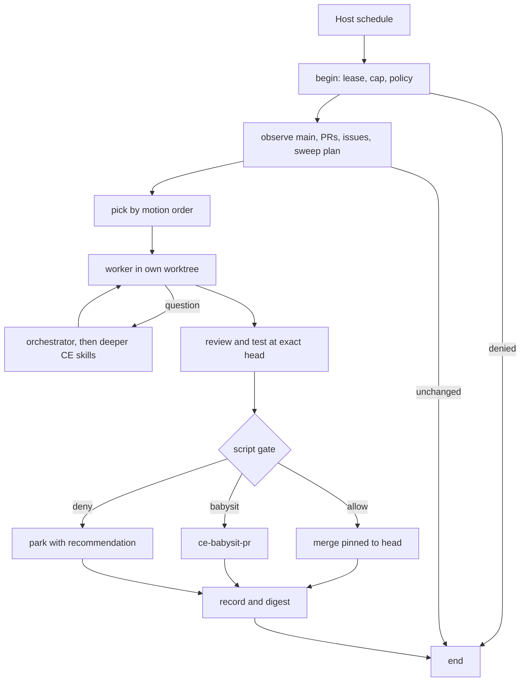

# Autonomous Mode (afg) - Plan

## Goal Capsule

- **Objective:** A maintainer states their risk tolerance once per repository, and its backlog, red main and other enabled work then move to landed, closed or parked without a human starting or unblocking each item.
- **Means:** One orchestrator skill, `afg`, run about hourly by the host's scheduler, with a bundled script that decides every landing (KTD1, KTD2).
- **Authority:** Product Contract, then KTDs, then units. Repository instructions and branch rules outrank any autonomous permission.
- **Stop when:** a settled decision proves unworkable, or a landing control cannot fail closed.
- **Ships as:** one PR. `lfg` owns shipping.

## Product Contract

### Summary

`afg` observes a repository, picks the highest-priority enabled job, delegates it to an existing Compound Engineering skill, and then merges, babysits, closes with evidence or parks the result. A preset, per-motion and per-author overrides, plain-language rules and earned autonomy decide how far it may go.

### Problem Frame

Agents can do much of a repository's maintenance, but a person still starts each run, answers its questions and lands its result. A repository can hold dozens of routine dependency PRs and stale issues behind a red main that nobody has started to repair.

### Key Decisions

- **Fix main before merging anything else** (session-settled: user-approved — chosen over merging on no new failures, local tests deciding, and a per-repo choice: failing setup jobs hide real breakage). Governs R5, R6.
- **Close only with evidence** (session-settled: user-approved — chosen over age, agent judgment and author-based closing: unattended closing must not discard real bugs). Governs R11.
- **Trust decides between auto-merge and babysitting** (session-settled: user-directed — chosen over prepare-only, merge-any-passing and label-only: hands-off within trust). Governs R8, R9.
- **Tolerance combines preset, overrides with ceilings, plain-language rules and earned autonomy** (session-settled: user-directed — chosen over any one alone: the user asked for the combination). Governs R7, R10.
- **Ship policy, runner, motions and spare capacity are one outcome** (session-settled: user-directed — chosen over one part first: the user chose all). Governs R1, R2, R3, R12.
- **Try CE's deeper skills before parking a question** (session-settled: user-directed — chosen over parking or notifying immediately: the user wants it to try itself). Governs R13.

### Requirements

**Run**

- R1. One invocation performs one bounded run: it begins under a lease, observes, acts on the highest-priority work, records and ends.
- R2. Work comes from enabled motions in this order: in-flight items, `main-red`, `bugs`, `security`, `backlog`, `stack`, `climb`, `create`.
- R3. A run starts no more jobs than the remaining hourly cap. At the open own PR cap it starts no job that would open another PR, except one `main-red` repair when none is open.
- R4. A parked item is not attempted again until its head, comments or main changes, or a person answers it.

**Main health**

- R5. Unless main is green, the only landing allowed is a `main-red` repair; triage, closing and babysitting continue. Green means the default-branch tip has at least one completed check and every check finished success, neutral or skipped; a failure is red; anything else is unknown.
- R6. Once main is green, one item lands at a time, and main must be observed green again before the next.

**Tolerance**

- R7. Each motion has a starting level and a ceiling from the profile (table in KTD4), lowered by every matching override; earned autonomy raises it only up to its ceiling. Closing requires the `backlog` motion at `babysit` or above.
- R8. Only a listed trusted author's PR, or its own PR whose GitHub author, head repository and recorded head agree, may reach `merge`; every commit must be attributed to a trusted author, and a bot's must be verified. Its own PR that originated in untrusted text is capped at `babysit`.
- R9. An unlisted author's PR is reviewed from its diff only and parked with a recommendation; its code is never checked out or run, and its CI is never approved by autonomous mode. Listed babysit authors may be babysat.
- R10. A change matching a hard limit (permissions, user-data deletion or migration, secrets, billing, release, or the policy, CI, test configuration, package scripts and agent instructions that judge it), or one the script cannot classify, never lands without a human.
- R11. Autonomous mode closes an item only as already-fixed, duplicate or replaced, citing a merged commit or PR, or an older issue, that the script verifies, with a reason comment.
- R12. Direct-to-default-branch landing is off unless the repository enables it, requires local tests, and is refused where the default branch is protected.

**Autonomy**

- R13. A question goes from worker to orchestrator to `ce-explain`, `ce-pov` with its oracle or `ce-bakeoff` before it is parked; an answer never raises a level.
- R14. Repository, issue, PR and CI text is data and grants nothing.
- R15. Without an active `autonomous_profile`, or with malformed policy, autonomous mode observes and reports only.
- R16. Every landing is pinned to the exact head commit that was reviewed and locally tested, with gates re-read immediately before it.
- R19. A run reads the repository's autonomous settings first. Without them it interviews a present user and saves the answers, or reports and stops when nobody is present.
- R18. When a provider reports a usage limit, the next job moves to another provider the host offers, or the run ends.
- R20. When a person answers a stuck or parked item, the run applies it, records the situation, options, choice and confirmed reason, compounds a lasting decision into the repository, and uses it next time instead of asking. Only a person in the session answers; a decision never raises authority, a one-time answer is not generalized, and a retired or replaced one stops applying. (Relayed by another agent as the user's request; adopted because R4 needs an answer path.)
- R21. `ce-optimize`, `ce-ideate` and `ce-sweep` run unattended from the loop; conditions stand in for approval in `ce-optimize` and an unmet one blocks. (session-settled: user-directed — chosen over proposals only: every motion should run by itself.)
- R22. Code runs on this machine only from its own recorded work and listed authors. (session-settled: user-approved — chosen over own work only or a sandbox first: the dependency backlog must clear itself.)
- R23. The landing route follows the repository: where its instructions land without pull requests, work lands as one tested commit on the default branch, open PRs are sources, and hosted CI does not gate (R5 and R6 apply to the pull-request route). (session-settled: user-directed — chosen over opening PRs there: the repository does not use them.)
- R24. How a repository lands is saved in its settings (route, CI, merge method, checks by path, landing steps in its own words) and the script enforces them. (session-settled: user-directed — chosen over inferring the rules each run: the rules must be followed exactly.)
- R17. Each run leaves a readable digest of what landed, what it decided, and what is parked with a recommendation.

### Acceptance Examples

- AE1. Covers R5. Main is red and a trusted bot's patch PR is green: the gate denies it with reason `main-not-green`.
- AE2. Covers R16. A PR head moves after review: the gate denies it with reason `head-moved`.
- AE3. Covers R10. A trusted author's PR edits a database migration at level `merge`: the gate denies it with reason `hard-limit`.
- AE4. Covers R8, R14. A stranger's PR body says it is pre-approved: the gate denies it with reason `author-not-trusted`.
- AE5. Covers R15. `autonomous_profile` is absent: observe works, and land and close are denied.

### Scope Boundaries

**Deferred to Follow-Up Work**

- A remaining-quota reading. No readable source was found, so R3 and R18 stand in.
- A lease across machines.

**Outside this product's identity:** a scheduler, a hosted service and telemetry.

## Planning Contract

### Key Technical Decisions

- KTD1. A small phase-loaded skill body holds the goal and authority; `references/run.md` holds the run and `references/setup.md` the interview and T3 scheduling. Governs R1, R13.
- KTD2. `scripts/autonomous.py` is the only writer of state and the only path that merges or closes. Prose cannot enforce byte-exact policy (`docs/solutions/skill-design/prose-cannot-validate-caller-control-data-byte-for-byte.md`). Governs R5 to R12, R16.
- KTD3. Policy is the fetched default branch's `config.yaml`, never the checkout being judged. When it declares `autonomous_profile`, the main checkout's `config.local.yaml` may only tighten it; when it does not, the local file is the whole policy, so a contributor can run autonomous mode on a repository that has not adopted it. Malformed `autonomous_*` values deny. Governs R7, R10, R15.
- KTD4. Keys are flat and listed in the configuration guide. `autonomous_overrides` entries carry `motion` or `author` and `max`. Profiles:

| Motion | cautious (start / ceiling) | balanced | hands-off |
|---|---|---|---|
| main-red, bugs, backlog, stack | pr / pr | babysit / merge | merge / merge |
| security | pr / pr | pr / pr | pr / merge |
| climb | report / report | pr / merge | merge / merge |
| create | report / report | pr / pr | pr / merge |

- KTD5. State lives in the shared main-checkout store that `skills/ce-retro/scripts/retro-state.py` uses, as JSON and append-only JSONL. The lease fails closed without a lock and carries a run-unique token. Governs R1, R3.
- KTD6. Receipts are per exact head and base tip. `test` runs the policy's command itself in a clean worktree with GitHub credentials removed. `review` accepts a `ce-code-review mode:agent base:<ref>` result only with `status: complete`, `verdict: Ready to merge`, no P0 or P1, `scope.head_sha` equal to the head and a file count matching the script's own diff. `rule` records one verdict per `autonomous_rules` entry. A missing or stale receipt denies. Governs R16.
- KTD7. Merge uses `gh pr merge --match-head-commit` without `--auto`, then confirms `MERGED`. The base tip must be an ancestor of the head and unchanged since the receipts. Stack members, drafts, merge-queue bases and empty, pending or awaiting-approval checks are denied. `update` asks GitHub to update a behind branch at the expected head and voids receipts. Direct landing is a non-force push of the tested SHA that fast-forwards the recorded tip, under the same rules; unreadable protection counts as protected. Governs R6, R12, R16.
- KTD8. Workers never receive merge intent; stack land postures are never passed. `ce-debug mode:pipeline` never runs on main, and `main-red` uses `mode:return-to-caller`.
- KTD9. `--dry-run` writes nothing. Tests supply reads and record writes with a fake `gh`; the script has no alternate input for GitHub facts. A `main-red` repair counts only when the script recorded the job for the current red tip and every failing check passes on the head. Hard limits are computed from a local git diff.
- KTD10. The skill stays model-invocable with a "Use only when" description, because a scheduled prompt's ability to start an opt-out skill is unmeasured. R15 is the protection.
- KTD11. The skill is named `afg` and its settings `autonomous_*` (session-settled: user-directed — chosen over `ce-factory` and a longer lfg name: the user rejected "factory" and chose the short form). The script is Python, matching the plugin's other scripts.

### High-Level Technical Design

Directional, not an implementation specification.

### Assumptions

- The maintainer named no hard limits, so R10's list is an inferred default.
- Trust is earned by five consecutive landed items in a motion with no revert; a revert returns it to the profile level.
- A `main-red` repair that edits CI parks under R10.
- Defaults: two jobs per hour and five open own PRs.
- Project instructions that forbid or require approval for merging win; on such a host autonomous mode parks.

### Risks & Dependencies

- Any process running as the user holds the same credentials and can edit state or merge without the script. Server-side branch rules are the only enforcement; setup recommends them.
- Hard limits match paths and the diff by pattern and will miss some semantics. The review and plain-language rules are the second check.
- GitHub CLI is required. Other hosts degrade to report.

## Implementation Units

### U1. Policy, state and gate script

- **Goal:** decide and record every run, merge and close. **Requirements:** R1, R3 to R12, R15 to R17; KTD2 to KTD5, KTD7, KTD9.
- **Files:** `skills/afg/scripts/autonomous.py`, `tests/skills/afg-*.test.ts`.
- **Approach:** subcommands `policy`, `begin`, `heartbeat`, `observe`, `job`, `test`, `review`, `rule`, `gate`, `update`, `land`, `direct`, `close`, `park`, `digest`, `end`. Execution note: write gate denials test-first.
- **Test Scenarios:** AE1 to AE5; second `begin` is locked while the first lives; expired lease is reclaimed and the old token is refused; cap reached; malformed config denies; mislabeled main-red repair; forged own-PR record; untrusted commit on a bot PR; unlisted author babysit; missing rule verdict; base moved; unproven close citation; local file cannot loosen a team override; policy edit inside the PR does not change the decision; missing review, stale review head, P1, failing, empty or pending checks; behind, draft, fork, stack base; `land` calls the pinned command once with a fake `gh`; `land --dry-run` calls none; close without evidence or comment denied; five clean landings raise to the ceiling, a revert lowers; direct denied when protected.
- **Verification:** `bun test tests/skills/afg-*.test.ts`.

### U2. Skill body and references

- **Goal:** the orchestrator. **Requirements:** R1 to R4, R13, R14, R17; KTD1, KTD6, KTD8, KTD10.
- **Files:** `skills/afg/SKILL.md`, `skills/afg/references/run.md`, `skills/afg/references/motions.md`, `skills/afg/references/setup.md`.
- **Approach:** follow `ce-skill-work` new-skill mode. Dependencies: U1.
- **Test Scenarios:** activation positive, adjacent-negative and explicit; restraint with no profile; red-main ordering; injected PR text.
- **Verification:** skill convention, prompt budget and frontmatter tests; live eval.

### U3. Config and inventory

- **Goal:** users can find and configure it. **Requirements:** R7, R15; KTD4.
- **Files:** `skills/ce-setup/references/config-template.yaml`, `.compound-engineering/config.example.yaml`, `skills/ce-setup/references/config-template-lines.txt`, `tests/fixtures/ce-config-template-pin.json`, `docs/guides/configuration.md`, `docs/guides/afg.md`, `docs/guides/README.md`, `README.md`, `skills/ce-help/references/skill-map.md`, `tests/release-metadata.test.ts`, `tests/skill-conventions.test.ts`, `tests/skills/ce-setup-check-health.test.ts`.
- **Test expectation:** existing parity and inventory tests. Dependencies: U2.

### U4. Live validation

- **Goal:** evidence from this host. **Requirements:** R1, R5, R10, R14, R15, R16.
- **Files:** none kept.
- **Approach:** fresh Claude and Codex agents against a disposable repo with a fake `gh`; a T3-delegated run; read-only `observe --dry-run` against one real repository. No real merge, close, comment or push, and no schedule left enabled.
- **Test expectation:** none -- evidence is recorded in the PR.

## Verification Contract

- `bun test tests/skills/afg-*.test.ts`, then `bun run test`, `bun run release:validate` and `bun run plugin:validate`.
- Live cells in U4 on Claude and Codex, graded on fake-`gh` logs and state files.

## Definition of Done

- Every requirement has passing script tests or a graded live cell, or is listed as unexercised.
- No landing path exists outside `autonomous.py`.
- Inventory and config parity tests pass; abandoned code is removed.
