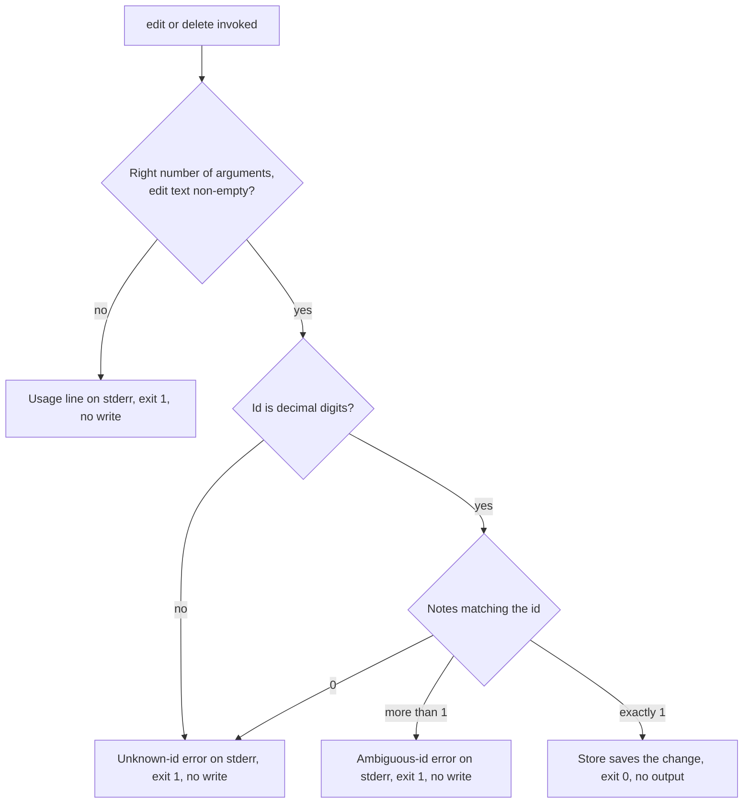

# Note Edit and Delete - Plan

## Goal Capsule

- **Objective:** A jot user can correct or remove a note from the terminal, and a mistyped id is reported as an error instead of changing nothing quietly or changing the wrong note.
- **Means:** Two new subcommands, `jot edit <id> <text>` and `jot delete <id>`, backed by new store operations (KTD1).
- **Authority:** Product Contract requirements (R-IDs) win on behavior. Key Technical Decisions win on mechanism within those requirements. Assumptions (AS-IDs) are unvalidated bets that a reviewer may overturn. Units override neither.
- **Execution profile:** One pull request, three units built in order U1 → U2 → U3.
- **Stop conditions:** Stop and report if meeting a requirement would mean changing the notes file away from a plain JSON array, or if the tests cannot keep away from the developer's real `~/.jot/notes.json`.
- **Who finishes:** The implementing agent builds and verifies locally. The calling pipeline reviews and ships.

---

## Product Contract

### Summary

Add `edit` and `delete` subcommands to the jot CLI so a note's text can be replaced or the note removed by id. Unknown ids fail loudly, with a non-zero exit. New-note ids stop colliding after a delete. README, usage text, and CHANGELOG describe the new commands.

### Problem Frame

Today the only way to fix or remove a note is to hand-edit `~/.jot/notes.json`, which the README lists as a known rough edge. Hand-editing invites mistakes in a file the CHANGELOG already reports as fragile. Users also get ids from `jot list` and `jot search`, so a mistyped id is likely. If that typo does nothing and says nothing, or changes a different note, the user loses trust in the tool.

### Requirements

**Editing**

- R1. `jot edit <id> <text>` replaces the text of the note with that id.

**Deleting**

- R2. `jot delete <id>` removes the note with that id and leaves every other note unchanged.

**Unknown ids**

- R3. When no note has the given id, `edit` and `delete` print an error to stderr and exit non-zero.

**Tests**

- R4. Automated tests cover editing, deleting, and the unknown-id error for both commands.

### Scope Boundaries

Considered and not built:

- File locking or atomic writes. The read-modify-write race already documented for `add` (`src/store.js`, CHANGELOG 0.4.0) applies to the new commands the same way, and fixing it is separate work. A concurrency fix for `add` would cover these commands too.
- Never reusing an id. With highest-id-plus-one (KTD3), deleting the newest note and then adding gives the new note that freed id. Avoiding this needs a stored counter, which changes the file format for every command. A report of a user acting on a stale id would change this call.
- A confirmation prompt before delete. jot has no interactive prompts and is meant to be scriptable.
- Editing tags, deleting several ids in one call, and undoing a delete.
- The other known rough edges: CSV comma quoting, search speed, tag case sensitivity.

#### Deferred to Follow-Up Work

- Make `npm test` work on newer Node. On the installed Node 24.21.0, `node --test test/` (the `package.json` script and the AGENTS.md command) fails before running any test, while `node --test` with no argument works. Changing the script and AGENTS.md is a separate decision about the project's supported Node versions.

---

## Planning Contract

### Key Technical Decisions

- KTD1. **The store changes data, and the CLI owns messages and exit codes.** `src/store.js` gets edit and delete operations that report how many notes matched the id (zero, one, or more) and save only when exactly one matched. `src/cli.js` turns that count into output and an exit code. Nothing in `store.js` prints or exits today, and keeping it that way leaves the wording in one place.
- KTD2. **Parse the id strictly before comparing.** Ids come from argv as strings, and stored ids are JSON numbers, so a direct strict comparison never matches. Accept only a string of decimal digits, then convert it to a number. Plain `Number()` would accept `""` as 0, `" 3 "` as 3, and `0x3` as 3. Anything that fails the parse takes the unknown-id path (AS3).
- KTD3. **New ids are the highest existing id plus one, starting at 1.** `addNote` uses `notes.length + 1`, so once a note is deleted the next `add` reuses an id that is still taken. This was reproduced: ids `[1,2,3]`, delete 2, then add, gives `[1,3,3]`. Highest-plus-one keeps the file a bare array, so `load`, `search`, and `export` don't change. A stored counter was rejected because it changes the file format (see Scope Boundaries).
- KTD4. **Tests run the real CLI as a child process with a temporary home directory.** The notes path is fixed from `os.homedir()` when `src/store.js` is first imported, so an in-process test would read and write the developer's real notes. The exit code required by R3 can only be observed from outside the process. Each test sets both `HOME` and `USERPROFILE` to a fresh temporary directory, because `os.homedir()` reads `USERPROFILE` on Windows.

### Assumptions

These are behaviors the request does not settle. Planning picked a default for each, and none has been confirmed by the requester.

- AS1. Edit changes only the text. The note's id, tag, and `created` timestamp stay as they were, and no `updated` field is added, so the CSV export columns stay the same.
- AS2. Ids are stable. Delete never renumbers the remaining notes, and `add` stops producing duplicate ids (KTD3). This changes how `add` assigns ids, which is a behavior change outside the two named commands.
- AS3. A non-numeric or malformed id (`abc`, `-1`, `1.5`, empty) is reported the same way as an unknown id.
- AS4. An unknown id leaves the notes file untouched. An unknown id on a machine with no notes file does not create the file or its directory.
- AS5. A missing id, missing or empty edit text, or extra positional arguments get that command's usage line on stderr, exit 1, and no write. Copying `add`'s unchecked argument handling would let `jot edit 3` save a note with no text, which makes every later `jot search` crash. It would also let an unquoted `jot edit 3 buy milk` silently save just "buy".
- AS6. When an id matches more than one note, the command refuses with an error, exits 1, and writes nothing. That can happen in files hand-edited the way the README describes, followed by `add`. Acting on the first match could change or delete the wrong note.
- AS7. Successful edit and delete print nothing and exit 0, the same as `add`.
- AS8. The README example block gains edit and delete lines and drops the "no way to edit or delete" rough edge. The CLI usage line lists the new commands. The CHANGELOG gets an `## Unreleased` entry, and the `package.json` version is not bumped.

### High-Level Technical Design

How the CLI resolves an `edit` or `delete` invocation (applies to both commands):

---

## Implementation Units

### U1. Edit and delete commands

- **Goal:** Users can replace a note's text or remove a note by id, and get an error with a non-zero exit when the id does not resolve to exactly one note.
- **Requirements:** R1, R2, R3, R4. AS1, AS3, AS4, AS5, AS6, AS7.
- **Dependencies:** None.
- **Files:**
  - Modify `src/store.js`
  - Modify `src/cli.js`
  - Create `test/edit-delete.test.js`
- **Approach:**
  1. In `src/store.js`, add an edit operation and a delete operation that take a numeric id and follow KTD1: count the matches, save only on exactly one match, and return the count.
  2. In `src/cli.js`, add `edit` and `delete` branches that check the argument count and edit text (AS5), parse the id (KTD2), call the store, and map the result as the High-Level Technical Design shows. Errors go to stderr with exit 1. The unknown-id message includes the id as the user typed it.
- **Patterns to follow:** The existing `if / else if` dispatch in `src/cli.js` and its `console.error` plus `process.exit(1)` error path. The `load()`/`save()` pair in `src/store.js`.
- **Test scenarios:** Every scenario runs the CLI as a child process under KTD4. The seam catches argument parsing, exit codes, stderr, and what actually lands in the notes file. It does not exercise concurrent writers, which are out of scope.
  - Seed notes 1 and 2. `edit 1 "new text"` exits 0. Note 1 has the new text with its original id, tag, and `created`, and note 2 is unchanged.
  - Seed notes 1, 2, and 3. `delete 2` exits 0, and the file holds notes 1 and 3 with their original ids and text.
  - `edit 99 "x"` against seeded notes exits non-zero, stderr contains `99`, and the notes file is byte-identical afterward.
  - `delete 99` against seeded notes exits non-zero, stderr contains `99`, and the notes file is byte-identical afterward.
  - `delete 1` with an empty temporary home exits non-zero, and no `.jot` directory is created.
  - `delete abc` exits non-zero and leaves the file unchanged.
  - `edit 1` with no text exits non-zero, and note 1 keeps its text.
  - `edit 1 buy milk` (three positional arguments) exits non-zero, and note 1 keeps its text.
  - Seed two notes that both have id 3. `delete 3` exits non-zero, and both notes remain.
- **Verification:** The new test file passes, and `jot list` in a temporary home shows the edited text and the deletion.

### U2. Collision-free ids for new notes

- **Goal:** A note added after a delete never shares an id with an existing note.
- **Requirements:** AS2.
- **Dependencies:** U1, because the test needs `delete`.
- **Files:**
  - Modify `src/store.js`
  - Modify `test/edit-delete.test.js`
- **Approach:** Change id assignment in `addNote` to KTD3. Leave the rest of the note shape as it is.
- **Patterns to follow:** The existing `addNote` in `src/store.js`.
- **Test scenarios:**
  - Add three notes, `delete 2`, then add one more. All ids in the file are distinct, and the new note's id is 4.
  - With no notes file, the first `add` gets id 1.
- **Verification:** The new scenarios pass alongside U1's.

### U3. Usage line, README, and CHANGELOG

- **Goal:** The new commands are discoverable from the usage error and the README, and the change is recorded.
- **Requirements:** AS8.
- **Dependencies:** U1.
- **Files:**
  - Modify `src/cli.js` (usage line only)
  - Modify `README.md`
  - Modify `CHANGELOG.md`
- **Approach:**
  1. Add `edit` and `delete` to the general usage line in `src/cli.js`.
  2. In `README.md`, add one `jot edit` and one `jot delete` example to the example block, and remove the rough-edge bullet about editing and deleting.
  3. In `CHANGELOG.md`, add an `## Unreleased` section above 0.4.0 covering the two commands and the id-assignment change from U2.
- **Test expectation:** none -- documentation and a usage string. U1's tests cover the command behavior.
- **Verification:** The README no longer claims notes can't be edited or deleted, and an unknown command prints a usage line that names `edit` and `delete`.

---

## Verification Contract

| Check | Command or method | Pass condition |
|---|---|---|
| Full test suite | `node --test` from the repo root | All tests pass. The existing `test.todo` in `test/export.test.js` stays a todo. |
| Isolation from real notes | Review `test/edit-delete.test.js` | Every CLI spawn sets `HOME` and `USERPROFILE` to a per-test temporary directory (KTD4). |
| Usage line | Run `node src/cli.js` with no command | Exits 1, and stderr names `edit` and `delete`. |

`npm test` and `node --test test/` fail on the installed Node 24.21.0 before any test runs, for reasons unrelated to this change (see Deferred to Follow-Up Work). Use `node --test` to verify.

---

## Definition of Done

- R1 through R4 hold, and every scenario listed under U1 and U2 is a passing test.
- `node --test` passes on the installed Node.
- U3's documentation and usage changes are in the diff.
- `package.json` and `AGENTS.md` are unchanged.
- No leftover code from abandoned approaches remains in the diff.
