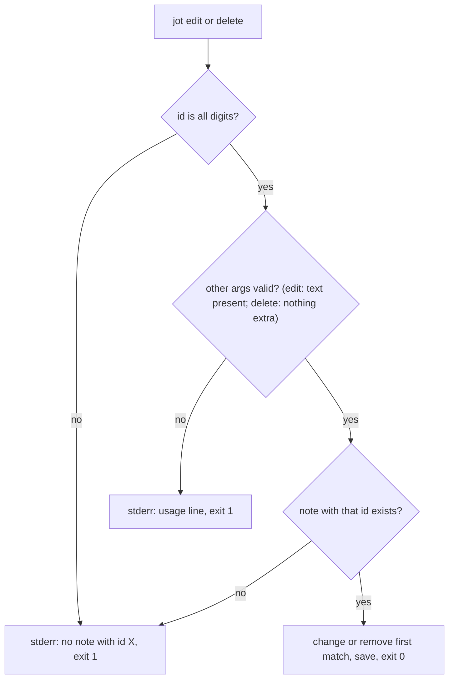

# Note Edit and Delete Commands - Plan

## Goal Capsule

- **Objective:** A jot user can correct or remove a note from the terminal instead of hand-editing `notes.json`, and a mistyped id fails loudly with nothing changed.
- **Means:** two new subcommands in the existing `src/cli.js` dispatch, backed by store functions that report whether the id was found (KTD2).
- **Authority:** Product Contract requirements win on behavior; Key Technical Decisions win on mechanism; units override neither.
- **Execution profile:** one PR, four units, built in order U1 → U2 → U3 → U4.
- **Stop conditions:** stop and report if the work would require changing `notes.json` from a bare array, or if tests cannot be kept off the real `~/.jot/notes.json`.
- **Who finishes:** `ce-work` implements and verifies locally; the calling pipeline reviews and ships.

---

## Product Contract

### Summary

Add `jot edit <id> <text>` and `jot delete <id>`, make new note ids unique once notes can be removed, and cover both commands and their error paths with tests that run against a throwaway home directory.

### Problem Frame

jot can add, list, search, and export notes, but cannot change or remove one. The README admits this under "Known rough edges": the only way to fix a typo or drop a stale note is to open `~/.jot/notes.json` by hand. Hand-editing already causes damage. `addNote` assigns `notes.length + 1`, so removing a note by hand and then adding one produces two notes with the same id, which was reproduced against a temp home during planning. A built-in delete would trigger the same collision on every use unless id assignment changes with it.

### Requirements

**Editing**

- R1. `jot edit <id> <text>` replaces the text of the note with that id and keeps its id, tag, and created timestamp.

**Deleting**

- R2. `jot delete <id>` removes the note with that id, and every other note keeps its id.

**Errors**

- R3. When the id matches no note, `edit` and `delete` print an error to stderr, exit non-zero, and leave the notes file untouched.

**Tests**

- R4. `node --test test/` covers edit, delete, and the unknown-id error for both commands, without reading or writing the developer's real `~/.jot/notes.json`.

### Scope Boundaries

- Editing a note's tag, undo, a delete confirmation prompt, and deleting several ids at once are not part of this change.
- Considered and not built: a stored id counter so the highest id is never reused after it is deleted. It would change `notes.json` from a bare array to an object and break every `load()` caller. Reusing an id whose note no longer exists confuses no remaining note. Revisit if notes gain external references by id.
- Considered and not built: repairing duplicate ids that existing files may already contain from earlier hand edits. `edit` and `delete` act on the first match (A3), which is deterministic, and new ids stop creating duplicates (KTD1). Revisit if users report notes they cannot reach.

#### Deferred to Follow-Up Work

- Locking around read-modify-write in `src/store.js`. The CHANGELOG records corruption from concurrent `jot add`. `edit` and `delete` use the same unlocked pattern and add no new failure mode.
- `jot add` with no text saves a note with no `text` field, after which every `jot search` crashes. This change guards `edit` against the same input (A1) but leaves `add` as it is.

---

## Planning Contract

### Key Technical Decisions

- KTD1. **New ids are the highest existing id plus one, or 1 for an empty store.** `notes.length + 1` collides as soon as any note is removed. Chosen over renumbering notes after a delete, which would change ids the user has already seen in `jot list`. Governs R2.
- KTD2. **`store.js` gains `editNote` and `deleteNote`, each returning whether a note was found and calling `save()` only on a hit; `cli.js` owns stderr output and `process.exit`.** This keeps the existing split, where store functions never exit the process. Skipping `save()` on a miss is what keeps R3's "file untouched" true, and it stops `jot delete 1` on a fresh machine from creating `~/.jot/notes.json`.
- KTD3. **An id argument is valid only if it is all ASCII digits; it is then converted to a number and compared with `===`.** CLI ids arrive as strings while stored ids are numbers, so a raw comparison never matches. `Number()` alone is too loose: `03`, `3.0`, `0x3`, and `1e0` all become 3, and `""` becomes 0. A malformed id gets the same error and exit code as an unknown id (R3).
- KTD4. **Tests run the real CLI as a child process with `HOME` (and `USERPROFILE`, for Windows) pointed at a fresh temp directory per test, and never statically import `src/store.js`.** `store.js` fixes its file path from `os.homedir()` when the module loads, and ESM hoists static imports above any code that could redirect `HOME`. A child process also lets tests check exit codes and stderr, which R3 and R4 require. This seam catches argv parsing, exit codes, stderr, and on-disk results. It misses nothing these commands do in-process, since they have no other callers.

### High-Level Technical Design

This sketch shows the intended order of checks for both commands. It is directional guidance for review, not an implementation spec. Every argument check runs before the store is touched, so a bad call never writes.

### Assumptions

These are planning bets nobody confirmed. Reviewers should check them first.

- A1. `jot edit <id>` with missing or empty text is a usage error: stderr, exit 1, no write. Otherwise the note's text would be erased and `search` would crash on it afterwards.
- A2. Everything after the id is joined with single spaces to form the new text, so `jot edit 3 buy oat milk` stores `buy oat milk`. Taking only the next argument, as `add` does, would silently replace a whole note with one word.
- A3. When an existing file already holds duplicate ids from earlier hand edits, `edit` and `delete` act on the first matching note in file order and on no other.
- A4. `jot delete` with extra arguments after the id is a usage error, so `jot delete 3 4` doesn't make it look like both notes were deleted.
- A5. Both commands print nothing on success, matching `add`. The unknown-id message reads `no note with id <arg>`, and the exit code is 1, matching the existing usage error.
- A6. The release notes go under a new `## Unreleased` heading in `CHANGELOG.md`, and `package.json` keeps version 0.4.0. Choosing the next version number is left to whoever cuts the release.

---

## Implementation Units

### U1. Unique id assignment

- **Goal:** `addNote` never gives a new note an id that an existing note already has.
- **Requirements:** R2, KTD1
- **Dependencies:** none
- **Files:** `src/store.js`, `test/edit-delete.test.js`
- **Approach:**
  1. Replace the `notes.length + 1` expression in `addNote` with the KTD1 rule.
  2. Create `test/edit-delete.test.js` with a small helper that makes a temp home, can seed `.jot/notes.json` with a fixture, runs `src/cli.js` with `process.execPath` per KTD4, and returns stdout, stderr, status, and the parsed notes file.
- **Patterns to follow:** `addNote` in `src/store.js`. `node:test` as used in `test/export.test.js`.
- **Test scenarios:**
  - A fixture with ids 1 and 3 (a gap), then `jot add "four"`, stores the new note with id 4.
  - An empty home, then `jot add "first"`, stores id 1.
- **Verification:** the new tests pass and `jot list` on a gapped fixture shows no repeated id after an add.

### U2. `jot edit`

- **Goal:** users can replace a note's text by id.
- **Requirements:** R1, R3, R4, KTD2, KTD3, A1, A2, A3, A5
- **Dependencies:** U1 (test helper)
- **Files:** `src/store.js`, `src/cli.js`, `test/edit-delete.test.js`
- **Approach:**
  1. Add `editNote(id, text)` to `src/store.js` per KTD2. It changes only `text` on the first match (A3).
  2. Add an `edit` branch to `src/cli.js`. Validate the id per KTD3, build the text per A2, reject missing text per A1, and map a `false` return to the R3 error.
  3. Add `edit` to the usage line.
- **Patterns to follow:** the `if/else if` dispatch and `console.error` + `process.exit(1)` in `src/cli.js`.
- **Test scenarios:**
  - Fixture notes 1 `milk` (tag `home`) and 2 `bread`. `jot edit 1 "oat milk"` exits 0. Note 1's text becomes `oat milk`, and its tag and created timestamp are unchanged. Note 2 is unchanged.
  - `jot edit 2 rye bread loaf` (unquoted) stores `rye bread loaf`.
  - `jot edit 9 "x"` against that fixture exits non-zero. Stderr names id 9, and the notes file is byte-for-byte unchanged.
  - `jot edit abc "x"` and `jot edit 01 "x"` exit non-zero with the same unknown-id error and no change.
  - `jot edit 1` with no text, and `jot edit 1 ""`, exit non-zero, and note 1 keeps its text.
  - A fixture with two notes that both have id 2: `jot edit 2 "new"` changes only the first.
  - `jot edit 1 "x"` against a fresh home with no notes file exits non-zero and creates no `.jot/notes.json`.
- **Verification:** all edit scenarios pass, and `jot list` shows edited text after an edit.

### U3. `jot delete`

- **Goal:** users can remove a note by id.
- **Requirements:** R2, R3, R4, KTD1, KTD2, KTD3, A3, A4, A5
- **Dependencies:** U1, U2 (shared id validation in `src/cli.js`)
- **Files:** `src/store.js`, `src/cli.js`, `test/edit-delete.test.js`
- **Approach:**
  1. Add `deleteNote(id)` to `src/store.js` per KTD2. It removes only the first match (A3).
  2. Add a `delete` branch to `src/cli.js`. Reuse the edit branch's id validation, reject extra arguments per A4, and map a `false` return to the R3 error.
  3. Add `delete` to the usage line.
- **Patterns to follow:** U2's branch in `src/cli.js`.
- **Test scenarios:**
  - Fixture notes 1, 2, and 3. `jot delete 2` exits 0, and the file holds notes 1 and 3 with their original ids and text.
  - After that delete, `jot add "four"` gets id 4, so no remaining id is repeated (U1 and U3 together).
  - `jot delete 9` exits non-zero. Stderr names id 9, and the file is unchanged.
  - `jot delete abc` exits non-zero with no change.
  - `jot delete 1 2` exits non-zero, and both notes remain.
  - A fixture with two notes that both have id 2: `jot delete 2` removes only the first.
  - `jot delete 1` against a fresh home exits non-zero and creates no `.jot/notes.json`.
- **Verification:** all delete scenarios pass, and `jot list` no longer shows a deleted note.

### U4. Docs

- **Goal:** the README and CHANGELOG describe the new commands, and the README no longer claims notes can't be edited or deleted.
- **Requirements:** R1, R2, A6
- **Dependencies:** U2, U3
- **Files:** `README.md`, `CHANGELOG.md`
- **Approach:**
  1. Add `jot edit` and `jot delete` examples to the README usage block.
  2. Remove the "no way to edit or delete" rough-edge line.
  3. Add an `## Unreleased` section to `CHANGELOG.md` naming both commands and the id fix.
- **Test expectation:** none -- documentation only.
- **Verification:** the README examples match the implemented argument order, and no stale rough-edge line remains.

---

## Verification Contract

| Gate | Command or check | Proves |
|---|---|---|
| Unit and CLI tests | `npm test` (runs `node --test test/`) | R1–R4, KTD1, KTD3, A1–A5 |
| Real-store safety | `~/.jot/notes.json` has the same mtime before and after the test run, or still doesn't exist | R4, KTD4 |
| Manual smoke | With `HOME` set to a temp dir: add three notes, edit one, delete one, add one, then `jot list` | End-to-end flow and unique ids |

---

## Definition of Done

- R1–R4 hold, and every U1–U3 test scenario exists and passes under `npm test`.
- The existing `test/export.test.js` todo still reports as todo, and no other test regresses.
- `README.md` and `CHANGELOG.md` match U4.
- The diff contains no abandoned attempts, debug output, or unused helpers.
